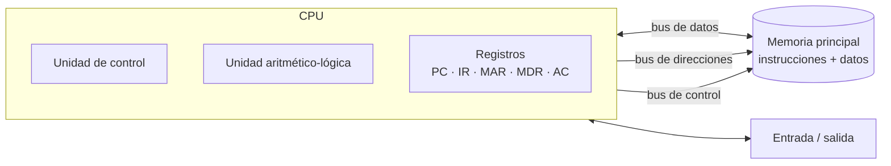

# 🧠 Arquitectura de computadores

Unidad del 1º trimestre: la arquitectura de Von Neumann, los buses, la jerarquía de memoria y la ejecución de instrucciones paso a paso.

## Índice

1. [Arquitectura de Von Neumann](#1-arquitectura-de-von-neumann)
2. [Buses y capacidad de direccionamiento](#2-buses-y-capacidad-de-direccionamiento)
3. [Jerarquía de memoria](#3-jerarquía-de-memoria)
4. [Rendimiento: MIPS y MFLOPS](#4-rendimiento-mips-y-mflops)
5. [Ciclo de instrucción](#5-ciclo-de-instrucción)
6. [Modos de direccionamiento](#6-modos-de-direccionamiento)

## 1. Arquitectura de Von Neumann

Programa y datos comparten la **misma memoria**, y la CPU los lee a través de buses comunes.



| Unidad | Función |
|---|---|
| **Unidad de control** | Busca las instrucciones en memoria, las decodifica y genera las señales de control que ejecutan cada micro-operación |
| **ALU** | Realiza las operaciones aritméticas (suma, resta…) y lógicas (AND, OR, comparaciones) |
| **Registros** | Memoria interna mínima y rapidísima: contador de programa (PC), registro de instrucción (IR), de dirección (MAR), de datos (MDR) y acumulador (AC) |
| **Memoria principal** | Guarda el programa en ejecución y sus datos |
| **Entrada/salida** | Comunicación con los periféricos |

## 2. Buses y capacidad de direccionamiento

| Bus | Transporta | Su anchura determina… |
|---|---|---|
| **Datos** | Datos e instrucciones, en ambos sentidos | Cuántos bits se transfieren de una vez |
| **Direcciones** | La posición de memoria o de E/S a la que se accede | Cuánta memoria se puede direccionar: 2ⁿ posiciones |
| **Control** | Órdenes y estados: lectura, escritura, reloj, interrupciones… | Cuántas señales de control hay |

Se usan buses separados porque cada uno tiene una función distinta y así pueden trabajar a la vez; un único bus compartido sería un cuello de botella.

**Ejemplos resueltos** (memoria direccionable por bytes):

- Bus de direcciones de **32 bits** → 2³² = 4 294 967 296 posiciones = **4 GiB**.
- Arquitectura de **16 bits** → 2¹⁶ = 65 536 posiciones = **64 KiB**.
- CPU con bus de datos de 8 bits, de direcciones de 16 y de control de 20:
  - Registros de **8 bits** y **8 bits** transferidos en cada acceso (los marca el bus de datos).
  - Memoria máxima: 2¹⁶ posiciones × 8 bits = **64 KiB = 524 288 bits**.
  - Hasta **20 señales de control**, entre ellas las de lectura y escritura en memoria.

## 3. Jerarquía de memoria

| Nivel | Capacidad típica | Tiempo de acceso típico | Volátil |
|---|---|---|---|
| Registros de la CPU | Bytes | < 1 ns | Sí |
| Caché (L1, L2, L3) | KB a decenas de MB | 1 – 10 ns | Sí |
| Memoria principal (RAM) | GB | 50 – 100 ns | Sí |
| Almacenamiento secundario (SSD, HDD) | Cientos de GB a TB | 0,1 ms (SSD) – 10 ms (HDD) | No |
| Almacenamiento terciario (cintas) | TB por cartucho | Segundos (acceso secuencial) | No |

Cuanto más cerca de la CPU, más rápida, más cara por byte y más pequeña. La **BIOS/UEFI** se guarda en memoria no volátil (ROM, hoy flash) para no perderse al apagar.

**Caché**:

- La primera vez que se lee un dato de la RAM se guarda una copia en caché; si se vuelve a necesitar (**localidad temporal y espacial**), se sirve mucho más rápido.
- ***Write-through***: cada escritura se hace a la vez en la caché y en la memoria principal. Más sencillo y siempre coherente, pero más lento.
- ***Write-back***: solo se escribe en la caché y el bloque se copia a memoria cuando se reemplaza (bit *dirty*). Más rápido, pero más complejo de mantener coherente.

## 4. Rendimiento: MIPS y MFLOPS

- **MIPS** (millones de instrucciones por segundo) = nº de instrucciones / (tiempo en segundos × 10⁶). Con el mismo programa, un procesador que lo ejecuta en 2 s rinde 5 veces más que uno que tarda 10 s.
- **MFLOPS**: millones de operaciones **en coma flotante** por segundo, más representativo para cálculo científico.

## 5. Ciclo de instrucción

Cada instrucción pasa por una **fase de búsqueda** (la misma para todas) y una **fase de ejecución** (distinta según la operación). La decodificación siempre va **después** de la búsqueda: la CPU no puede interpretar una instrucción que aún no ha leído.

```text
Búsqueda:   MAR ← PC      MDR ← M[MAR]      IR ← MDR      PC ← PC + 1
Ejecución:  decodificar IR → operar según el código de operación
```

### Ejercicio resuelto

Máquina de acumulador con instrucciones de 4 dígitos: **código de operación** (1 dígito) + **dirección** (3 dígitos).

| Código | Operación |
|---|---|
| 1 | Cargar AC desde memoria |
| 2 | Almacenar AC en memoria |
| 3 | Sumar al AC |
| 4 | Restar al AC |
| 5 | Multiplicar el AC |
| 6 | Dividir el AC |

Programa: `100: 1300` · `101: 3301` · `102: 2301`, con los datos `300: 0016` y `301: 0007`.

| Instrucción | Fase | PC | MAR | MDR | IR | AC | Qué ocurre |
|---|---|---|---|---|---|---|---|
| 1300 | Búsqueda | 100 → 101 | 100 | 1300 | 1300 | — | Se lee la instrucción |
| | Ejecución | 101 | 300 | 0016 | 1300 | **0016** | AC ← M[300] |
| 3301 | Búsqueda | 101 → 102 | 101 | 3301 | 3301 | 0016 | Se lee la instrucción |
| | Ejecución | 102 | 301 | 0007 | 3301 | **0023** | AC ← AC + M[301] |
| 2301 | Búsqueda | 102 → 103 | 102 | 2301 | 2301 | 0023 | Se lee la instrucción |
| | Ejecución | 103 | 301 | **0023** | 2301 | 0023 | M[301] ← AC (escritura) |

Al terminar, la posición 301 contiene la suma: **0023**. En la práctica se simularon del mismo modo otros tres programas con restas, multiplicaciones y divisiones.

## 6. Modos de direccionamiento

Cómo indica una instrucción dónde está su operando. Ejemplo con la instrucción `LEER 5`, un registro de desplazamiento con valor 3 y esta memoria:

| Posición | 5 | 8 | 20 |
|---|---|---|---|
| Contenido | 20 | 11 | 7 |

| Modo | La instrucción contiene… | Operando obtenido | Accesos a memoria |
|---|---|---|---|
| **Inmediato** | El propio dato | 5 | 0 |
| **Directo** | La dirección del dato | M[5] = 20 | 1 |
| **Indirecto** | La dirección donde está la dirección del dato | M[M[5]] = M[20] = 7 | 2 |
| **Relativo** | Un valor que se suma a un registro | M[5 + 3] = M[8] = 11 | 1 |

En una instrucción, el **código de operación** es obligatorio; los operandos pueden no existir (por ejemplo, en las máquinas de pila, que toman los datos de la cima de la pila).
