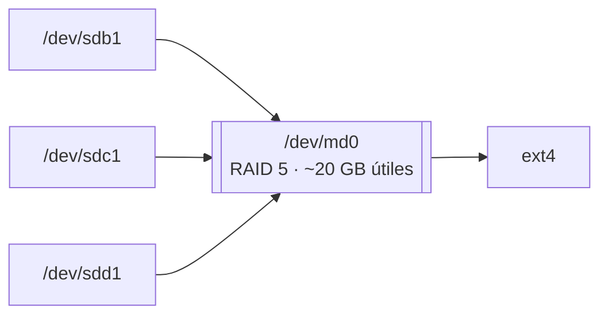

# 🏢 CPD, SAI y RAID

Prácticas del 3º trimestre orientadas a servidores: diseñar una pequeña sala de servidores, conectar y gestionar un **SAI**, montar un **RAID 5 por software** en Linux e inventariar el hardware de un sistema.

## Índice

1. [Diseño de un CPD](#1-diseño-de-un-cpd)
2. [SAI: conexión y software de gestión](#2-sai-conexión-y-software-de-gestión)
3. [RAID 5 con mdadm](#3-raid-5-con-mdadm)
4. [Añadir un disco en caliente](#4-añadir-un-disco-en-caliente)
5. [Inventario de hardware en Linux](#5-inventario-de-hardware-en-linux)

## 1. Diseño de un CPD

**Estación de trabajo frente a todo en uno**: se compararon una estación de trabajo con Xeon W y gráfica profesional (unos 4800 €) y un todo en uno con Core i7 de 12.ª generación, 32 GB DDR5 y 1 TB SSD (unos 1950 €). Para el uso planteado salía más rentable el todo en uno: más memoria y almacenamiento por menos de la mitad de precio.

**Sala de servidores** para una empresa pequeña:

| Elemento | Elección | Motivo | Precio |
|---|---|---|---:|
| Armario *rack* | 22U con puerta de cristal | Espacio para servidores y NAS, y revisión visual sin abrir | 699 € |
| Servidor de datos | Dell PowerEdge R340 (1U) | Fabricante fiable y ampliable | 1772 € |
| Servidor de aplicaciones | Dell PowerEdge R340 con más recursos | Rendimiento para las aplicaciones | 3110 € |
| NAS | Synology de 2 bahías | La opción de sobremesa más económica; un NAS de *rack* se salía del presupuesto | 203 € |
| Switch | Cisco Business CBS220 de 24 puertos gigabit | Gestionable y con puertos suficientes | 235 € |
| SAI | Salicru de 2000 VA | Autonomía suficiente para apagar los equipos de forma ordenada | 208 € |
| **Total** | | Sin instalación ni protección contra incendios | **6227 €** |

Además: **mantenimiento externo** con una empresa especializada en CPD (incluida la extinción de incendios) y **control de acceso** físico, normalmente con tarjeta o datos biométricos.

**Software de inventario**: Network Inventory Advisor escanea la red y el hardware y software de cada equipo, controla las licencias y exporta informes a hoja de cálculo. Es de pago, con prueba gratuita, y sus requisitos son modestos (servidor con CPU de 1 GHz, 512 MB de RAM y 50 MB de disco).

## 2. SAI: conexión y software de gestión

SAI **Salicru SPS 700 ONE** (*line-interactive*) conectado por USB a un equipo con arranque dual Windows 10 / Ubuntu 22.04.

- **Windows**: el fabricante ofrece **ViewPower** (monitorización: modo de funcionamiento, tensiones de entrada y salida, estado de la batería) y **ShutdownWizard** (apagado ordenado cuando se agota la batería). Ojo: la web ofrece varias aplicaciones y no todas son compatibles con cada modelo.
- **Ubuntu**: la versión de ViewPower para Linux se instala con su asistente, que trae su propio entorno Java.
- **Ubuntu Server** (sin interfaz gráfica): la alternativa estándar es **NUT** (*Network UPS Tools*). En la práctica se instaló y se abrió su fichero de configuración; los pasos para dejarlo funcionando serían:

  ```bash
  sudo apt install nut
  sudo nut-scanner -U            # detecta el SAI por USB y propone el controlador adecuado
  sudo nano /etc/nut/ups.conf    # pegar la sección que devuelve nut-scanner
  ```

  ```ini
  # /etc/nut/ups.conf (el controlador depende del modelo; lo indica nut-scanner)
  [sai]
      driver = nutdrv_qx
      port = auto
      desc = "SAI del servidor"
  ```

  ```bash
  sudo upsdrvctl start           # arrancar el controlador
  upsc sai@localhost             # estado del SAI: carga, batería, tensión…
  ```

  La configuración se completa con `nut.conf` (modo `standalone`), `upsd.users` y `upsmon.conf`, que define qué hacer cuando la batería se agota.

## 3. RAID 5 con mdadm

Máquina virtual de Ubuntu con **tres discos virtuales de 10 GB** añadidos en VirtualBox.



```bash
lsblk -e7                                      # discos disponibles (sin dispositivos loop)
sudo apt install mdadm rsync initramfs-tools -y

sudo fdisk /dev/sdb                            # repetir en sdc y sdd:
#   n → p → 1 → Intro → Intro   partición primaria que ocupa todo el disco
#   t → fd                      tipo "Linux raid autodetect"
#   w                           escribir y salir

sudo mdadm -C /dev/md0 -l raid5 -n 3 /dev/sd[b-d]1
sudo mdadm --detail /dev/md0                   # estado y progreso de la sincronización
sudo mkfs.ext4 /dev/md0
```

`mdadm --detail` mostraba justo después de crearlo el estado `clean, degraded, recovering` con el tercer disco como *spare rebuilding*: es la **sincronización inicial** de la paridad, que termina sola. La capacidad útil es la de *n − 1* discos: **unos 20 GB** con tres de 10 GB.

**Prueba de tolerancia a fallos**:

1. Con el volumen montado, crear una carpeta con tres ficheros de texto.
2. **Desconectar uno de los discos** en VirtualBox (puerto SATA 2).
3. Con el RAID degradado, borrar uno de los ficheros y crear otro nuevo: el volumen sigue funcionando.
4. Volver a conectar el disco: los cambios hechos durante el fallo se conservan y el RAID se reconstruye.

En la práctica el volumen se montó desde el explorador de archivos. Desde la terminal:

```bash
sudo mkdir -p /mnt/raid
sudo mount /dev/md0 /mnt/raid
```

Para que el RAID conserve su nombre y se monte solo al arrancar, hay que guardar su definición y añadirlo a `/etc/fstab`. Sin este paso, tras reiniciar reaparece con otro nombre (`/dev/md127`), como ocurrió en la práctica:

```bash
sudo mdadm --detail --scan | sudo tee -a /etc/mdadm/mdadm.conf
sudo update-initramfs -u
echo '/dev/md0  /mnt/raid  ext4  defaults  0  2' | sudo tee -a /etc/fstab
```

## 4. Añadir un disco en caliente

En VirtualBox, un disco se puede añadir **con la máquina encendida** si el puerto SATA está marcado como *Conectable en caliente*:

1. `sudo fdisk -l` para ver los discos actuales.
2. En la configuración de la VM, crear un disco nuevo de 20 GB y conectarlo al controlador SATA sin apagarla.
3. `sudo fdisk -l` de nuevo: aparece el disco de 20 GB.

## 5. Inventario de hardware en Linux

| Orden | Información |
|---|---|
| `sudo lshw -short` | Resumen de todo el hardware (sin `-short`, informe completo) |
| `lscpu` | Procesador: arquitectura, núcleos, hilos, cachés |
| `lspci` | Dispositivos PCI: gráfica, red, controladoras |
| `lsusb` | Dispositivos USB |
| `free -h` | Memoria RAM y *swap* |
| `lsblk` | Discos y particiones |
