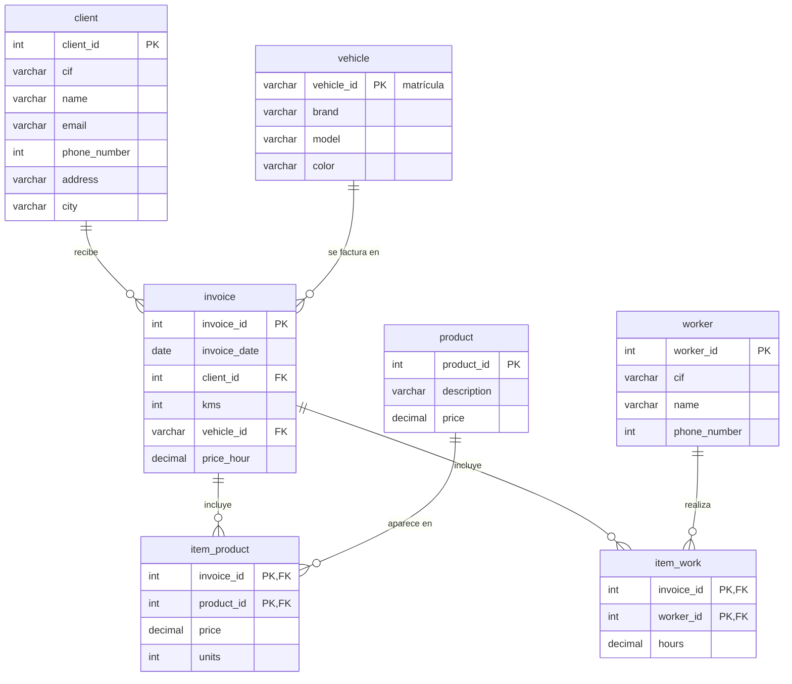
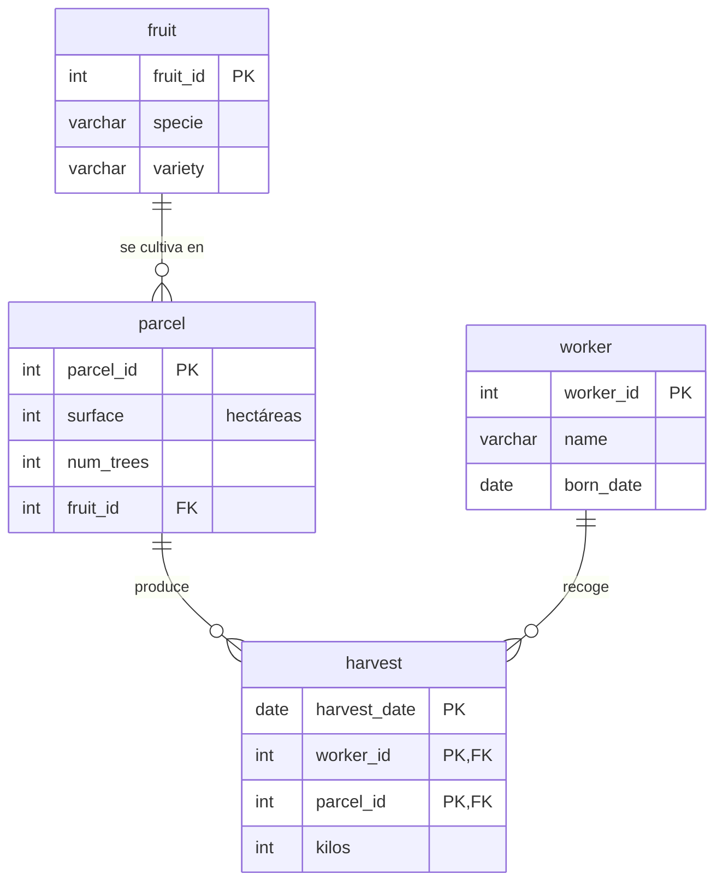
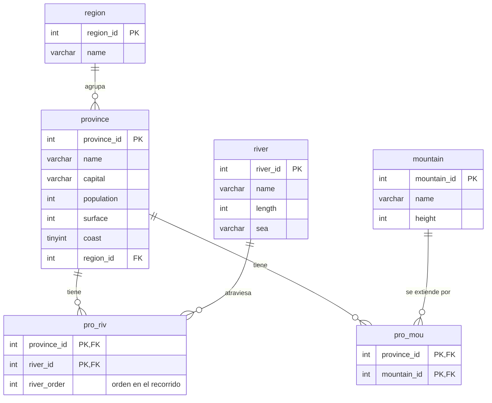
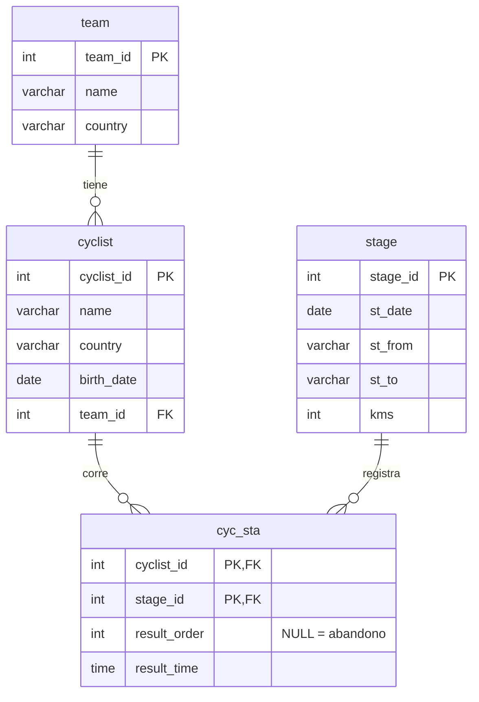
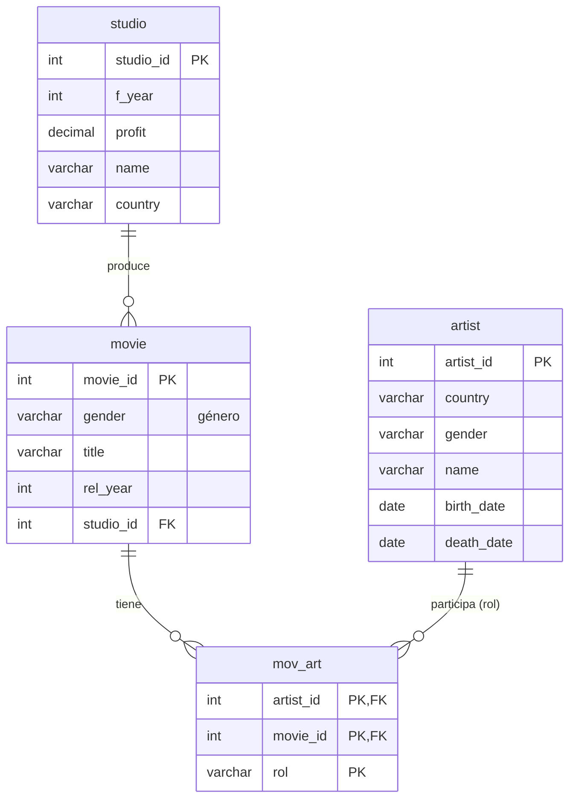
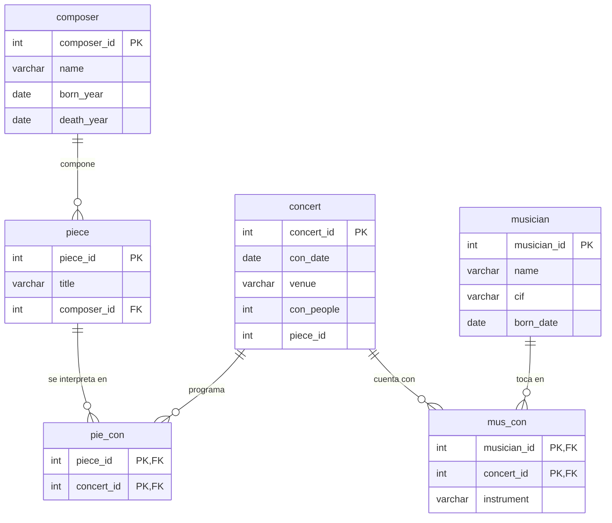
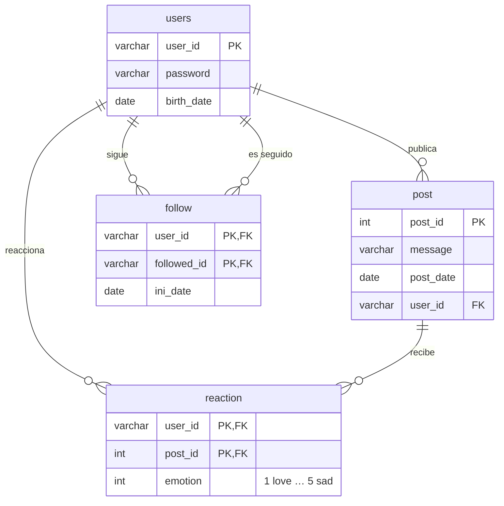
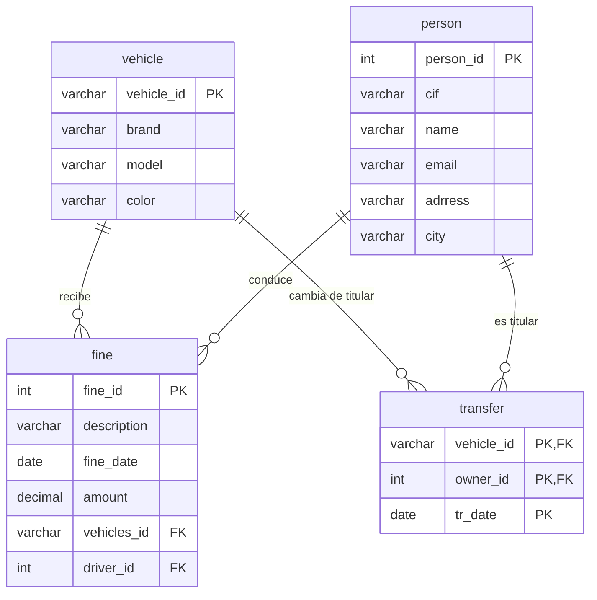

# 🗃️ GBD · Gestión de Bases de Datos

Diseño de bases de datos relacionales y SQL sobre **MySQL**: del modelo entidad-relación a las consultas multitabla, las subconsultas y la programación de funciones, procedimientos y disparadores.

Todo el trabajo de este módulo es código: **25 scripts SQL** organizados en tres bloques que siguen el orden en que se trabajaron durante el curso.

| Bloque | Trimestre | Contenido | Scripts |
|---|---|---|---|
| [1. DDL y consultas](1-ddl-y-consultas/) | 1º | Diseño E/R, `CREATE TABLE`, claves, `INSERT`, consultas con equijoin, funciones de agregado y `GROUP BY` | 13 |
| [2. Consultas avanzadas](2-consultas-avanzadas/) | 2º | `LEFT JOIN`, `HAVING`, subconsultas, `IF`/`CASE`, vistas, transacciones y modificación de datos | 5 |
| [3. Rutinas almacenadas](3-rutinas-almacenadas/) | 3º | Funciones, procedimientos con parámetros `OUT` y disparadores de auditoría y validación | 7 |

## Bases de datos de trabajo

| Base de datos | Dominio | Esquema | Consultas | Avanzadas | Rutinas |
|---|---|:---:|:---:|:---:|:---:|
| `car_repair_garage` | Taller mecánico: clientes, vehículos, facturas, piezas y mano de obra | ✅ | ✅ | ✅ | ✅ |
| `fruits` | Explotación frutícola: parcelas, jornaleros y cosechas | ✅ | ✅ | ✅ | |
| `spain_geo` | Geografía de España: comunidades, provincias, ríos y montañas | ✅ | ✅ | ✅ | ✅ |
| `la_vuelta` | Carrera ciclista: equipos, ciclistas, etapas y clasificaciones | ✅ | ✅ | | |
| `cinema` | Estudios, películas y artistas | ✅ | ✅ | | |
| `orchestra` | Orquesta: músicos, compositores, piezas y conciertos | ✅ | | ✅ ¹ | |
| `social_media` | Red social: usuarios, publicaciones, seguidores y reacciones | ✅ | | | |
| `traffic` | Tráfico: vehículos, personas, multas y transferencias | ✅ | | | |
| `parking` | Aparcamiento: plazas, vehículos, estancias y tarifas | ² | | ✅ | ✅ |
| `cooking` | Cocina: recetas, ingredientes, stock y comandas | ² | | | ✅ |

¹ Las consultas avanzadas usan la versión de la base de datos de la orquesta proporcionada en clase, con un esquema algo distinto al diseñado en el primer trimestre.
² El script de creación de `parking` y `cooking` se proporcionó en clase y no está incluido; los ficheros contienen solo las consultas y rutinas.

## Diagramas entidad-relación

Generados a partir de los scripts de creación de tablas.

<details>
<summary><b>car_repair_garage</b> · taller mecánico</summary>



</details>

<details>
<summary><b>fruits</b> · explotación frutícola</summary>



</details>

<details>
<summary><b>spain_geo</b> · geografía de España</summary>



</details>

<details>
<summary><b>la_vuelta</b> · carrera ciclista</summary>



</details>

<details>
<summary><b>cinema</b>, <b>orchestra</b>, <b>social_media</b> y <b>traffic</b></summary>









</details>

## Lo que se practica en cada bloque

### 1. DDL y consultas (1º trimestre)

- **Diseño**: del enunciado al diagrama E/R y de ahí a tablas con claves primarias simples y compuestas, entidades débiles y claves ajenas.
- **Consultas básicas**: proyección, `WHERE` con `AND`/`OR`/`BETWEEN`/`IN`/`LIKE`, `IS NULL`, `ORDER BY`, `DISTINCT`.
- **Multitabla**: producto cartesiano frente a equijoin, uniones de tres y cuatro tablas y autocombinaciones (la misma tabla dos veces).
- **Agregados**: `COUNT(*)` frente a `COUNT(columna)` y `COUNT(DISTINCT …)`, `SUM`, `AVG`, `MIN`, `MAX` y `GROUP BY`.
- **Funciones**: fechas (`YEAR`, `MONTH`, `DAY`, `TIMESTAMPDIFF`, `CURRENT_DATE`), cadenas (`SUBSTR`, `LOCATE`), `ROUND` e `IFNULL`.

```sql
-- car_repair_garage: nombres de clientes que han comprado aceite
SELECT DISTINCT c.name
FROM client c, invoice i, item_product ip, product p
WHERE c.client_id = i.client_id
  AND i.invoice_id = ip.invoice_id
  AND ip.product_id = p.product_id
  AND p.description LIKE "Oil%";
```

### 2. Consultas avanzadas (2º trimestre)

- **`LEFT JOIN`** para que aparezcan también las filas sin correspondencia (clientes sin facturas, provincias sin ríos…).
- **`HAVING`** para filtrar grupos y **subconsultas** en `WHERE`, `FROM` y `HAVING`, con `ALL`, `IN` y `NOT IN`.
- **Lógica condicional** con `IF()` y `CASE` para clasificar productos por precio o estancias por duración.
- **Vistas** para reutilizar consultas complejas y **transacciones** (`START TRANSACTION` / `ROLLBACK`) para probar modificaciones sin riesgo.
- **DML y DDL sobre datos existentes**: `INSERT`, `UPDATE`, `DELETE`, `ALTER TABLE`, claves autonuméricas y `LAST_INSERT_ID()`.

```sql
-- fruits: el mejor recolector (subconsulta en HAVING)
SELECT worker_id, SUM(kilos)
FROM harvest
GROUP BY worker_id
HAVING SUM(kilos) >= ALL (SELECT SUM(kilos) FROM harvest GROUP BY worker_id);
```

### 3. Rutinas almacenadas (3º trimestre)

- **Funciones** que devuelven un valor: importe de una factura, precio vigente en una fecha, clasificación energética de una receta o frases generadas a partir de los datos.
- **Procedimientos** con parámetros de entrada y salida (`OUT`) que devuelven códigos de estado: entrada y salida de vehículos del parking, *upsert* de ingredientes y comandas con control de stock.
- **Disparadores** (`BEFORE`/`AFTER … FOR EACH ROW`): auditoría de inserciones, cambios y borrados, y reglas de negocio que abortan la operación con `SIGNAL SQLSTATE`.

```sql
-- cooking: impide subir el precio de un ingrediente más de un 10 %
DELIMITER //
CREATE TRIGGER no_increase_price
AFTER UPDATE ON ingredient FOR EACH ROW
BEGIN
    IF old.price * 1.10 < new.price THEN
        SIGNAL SQLSTATE '20003' SET message_text = 'Price increases not allowed';
    END IF;
END//
DELIMITER ;
```

## Cómo usar los scripts

Los scripts de esquema crean las tablas en la base de datos activa, así que primero hay que crearla y seleccionarla:

```bash
mysql -u root -p -e "CREATE DATABASE car_repair_garage"
mysql -u root -p car_repair_garage < 1-ddl-y-consultas/car_repair_garage.sql
```

Los ficheros de consultas y rutinas están pensados para ejecutarse **por partes** desde un cliente SQL (MySQL Workbench, DBeaver, la extensión de VS Code…), ejercicio a ejercicio: algunos repiten una misma rutina con varias soluciones o incluyen consultas de prueba cuyo resultado depende de la fecha actual.

## Notas

- Los datos de ejemplo se han **anonimizado**: correos con dominios reservados (`.example`), teléfonos ficticios y localidades genéricas. En `spain_geo` se conservan los datos reales de población y superficie, que son públicos.
- Los enunciados y comentarios se mantienen tal como se escribieron durante el curso; los nombres de tablas y columnas están en inglés porque así se planteaban los ejercicios.
- `DECIMAL`, `INT(n)` y demás tipos siguen la sintaxis de MySQL/MariaDB.
