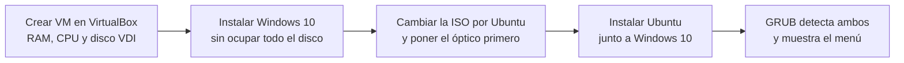
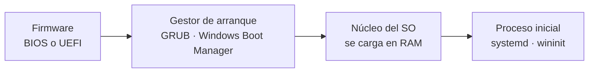

# 🧩 Virtualización, arranque dual y licencias

Prácticas del 1º trimestre de ISO: montar un laboratorio con máquinas virtuales, instalar dos sistemas operativos en la misma máquina con un menú de arranque y entender las licencias de software y el proceso de arranque.

## Índice

1. [Virtualización](#1-virtualización)
2. [Práctica: máquina virtual con arranque dual](#2-práctica-máquina-virtual-con-arranque-dual)
3. [El proceso de arranque](#3-el-proceso-de-arranque)
4. [Licencias de software](#4-licencias-de-software)

## 1. Virtualización

La virtualización permite ejecutar varios sistemas operativos aislados sobre el mismo hardware gracias a un **hipervisor**, que reparte CPU, memoria, disco y red entre las máquinas virtuales.

| Tipo de hipervisor | Se ejecuta sobre… | Ejemplos |
|---|---|---|
| **Tipo 1** (*bare metal*) | El hardware directamente | VMware ESXi, Proxmox VE, Hyper-V |
| **Tipo 2** (alojado) | Un sistema operativo anfitrión | VirtualBox, VMware Workstation, Parallels Desktop |

Además de máquinas completas, se virtualizan **escritorios** (VDI), **aplicaciones**, **servidores**, **almacenamiento** y **redes**.

**Ventajas** que se trabajaron en la práctica:

- **Aislamiento**: lo que ocurre dentro de la VM (un malware, una mala configuración) no afecta al anfitrión.
- **Instantáneas** para volver a un estado anterior antes de un cambio arriesgado.
- **Ahorro**: varios servidores en un único equipo físico, con menos consumo y espacio.
- **Laboratorio**: todas las prácticas del curso (Linux, Windows Server, redes) se hicieron en VirtualBox.

| Software | Licencia | Notas |
|---|---|---|
| VirtualBox | Libre (GPLv3); el *Extension Pack* es gratuito para uso personal y educativo | Windows, Linux y macOS |
| VMware Workstation Pro | Propietaria, gratuita desde 2024 | Windows y Linux |
| Hyper-V / Windows Sandbox | Incluidos en Windows Pro y Enterprise | Sandbox es una VM desechable para probar software |
| Parallels Desktop | Propietaria, con periodo de prueba | macOS |

## 2. Práctica: máquina virtual con arranque dual

**Objetivo**: una sola máquina virtual con **Windows 10** y **Ubuntu 22.04** que, al encenderse, muestre un menú para elegir sistema.

1. **Crear la VM**: tipo *Windows 10 (64-bit)*, memoria y núcleos dentro de la zona verde del asistente (sin restar recursos imprescindibles al anfitrión) y un disco virtual VDI de tamaño dinámico con espacio para los dos sistemas.
2. **Instalar Windows 10** desde su ISO, dejando espacio sin particionar para Ubuntu.
3. **Preparar el segundo sistema**: en *Configuración › Almacenamiento* se sustituye la ISO de Windows por la de Ubuntu 22.04.3 y, en *Sistema › Orden de arranque*, se sube la unidad óptica al primer puesto.
4. **Instalar Ubuntu** eligiendo **"Instalar Ubuntu junto a Windows 10"** e instalación mínima para aligerar la VM.
5. **Comprobar**: tras retirar la ISO y reiniciar, aparece el menú de **GRUB** con las dos entradas.

> ¿Por qué primero Windows? Su instalador reescribe el arranque sin tener en cuenta otros sistemas; el de Ubuntu, en cambio, detecta Windows (`os-prober`) y lo añade al menú de GRUB.

## 3. El proceso de arranque

| | BIOS (Legacy) | UEFI |
|---|---|---|
| Tabla de particiones | MBR: hasta 4 primarias y discos de 2 TiB | GPT: 128 particiones y discos enormes |
| Dónde está el cargador | Primer sector del disco | Partición de sistema EFI (FAT32) |
| Interfaz | Texto | Gráfica, con ratón |
| Seguridad | — | *Secure Boot*: solo arranca software firmado |

Los **gestores de arranque** más comunes son **GRUB 2** (Linux, permite elegir sistema y parámetros del núcleo), **Windows Boot Manager** y **systemd-boot**. Un gestor desactualizado o mal configurado puede impedir el arranque o abrir la puerta a *bootkits*, de ahí la importancia de *Secure Boot* y de mantenerlo actualizado.

## 4. Licencias de software

Una licencia es el contrato que fija qué puede hacer el usuario con un programa. Todo software tiene autor y derechos de autor; lo que cambia es qué permisos concede la licencia.

| Tipo | Qué permite | Ejemplos |
|---|---|---|
| **Propietaria** | Usar el programa en las condiciones del fabricante; no se puede estudiar, modificar ni redistribuir | Windows, Microsoft Office |
| **Libre con *copyleft*** | Usar, estudiar, modificar y redistribuir, siempre que las obras derivadas mantengan la misma licencia | GPL (Linux, VirtualBox) |
| **Copyleft débil** | Como la anterior, pero se puede enlazar desde software con otra licencia | LGPL, MPL (Firefox) |
| **Permisiva** | Casi cualquier uso, incluido integrarlo en software propietario, conservando el aviso de autoría | MIT, BSD, Apache 2.0 |
| **Dominio público** | Sin restricciones: el autor renuncia a sus derechos | SQLite, CC0 |
| **Gratuita / de prueba** | Usar sin pagar (*freeware*) o durante un tiempo limitado (*trial*); no da acceso al código | — |

> "Libre" se refiere a libertad, no a precio: el software libre puede venderse y un programa gratuito puede ser propietario.
