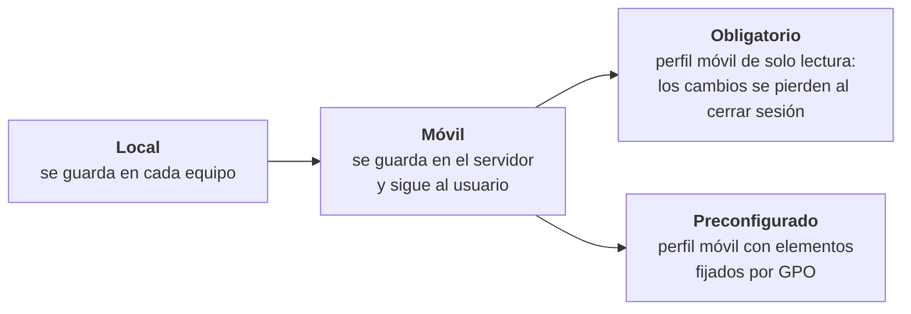

# 3. Usuarios, carpetas y perfiles

En los ejemplos, el servidor se llama `SERVIDOR` y el dominio es `prueba.local`.

## Usuarios y grupos

En *Usuarios y equipos de Active Directory*, dentro de la estructura de unidades organizativas creada en la [guía 1](01-instalacion-y-active-directory.md):

1. **Grupos** en cada sub-UO (`G1BACH`, `G1ESO`…): ámbito **global** y tipo **seguridad**.
2. **Usuarios** en su UO y miembros de su grupo. Al crearlos, marcar *El usuario debe cambiar la contraseña en el siguiente inicio de sesión*.
3. **Restricciones** en *Propiedades › Cuenta*:
   - **Horas de inicio de sesión**: franjas permitidas por día de la semana.
   - **Iniciar sesión en…**: lista de equipos desde los que el usuario puede entrar.

```powershell
$ou = "OU=1BACH,OU=BACH,DC=prueba,DC=local"
New-ADGroup -Name "G1BACH" -GroupScope Global -GroupCategory Security -Path $ou
New-ADUser -Name "Usu1 G1BACH" -SamAccountName "usu1.g1bach" -Path $ou `
    -AccountPassword (Read-Host -AsSecureString "Contraseña inicial") `
    -ChangePasswordAtLogon $true -Enabled $true
Add-ADGroupMember -Identity "G1BACH" -Members "usu1.g1bach"
Set-ADUser "usu1.g1bach" -LogonWorkstations "PC01,PC02"
```

## Unir un cliente Windows 10 al dominio

1. **Red**: en el adaptador de ambas máquinas, IPv4 estática en la misma red y, en el cliente, el **DNS preferido apuntando a la IP del servidor**. Sin ese DNS el cliente no encuentra el dominio.
2. En el cliente, *Configuración › Sistema › Acerca de › Cambiar el nombre de este equipo (avanzado) › Cambiar…*, seleccionar **Dominio** y escribir `prueba` (nombre NetBIOS) o `prueba.local`.
3. Introducir las credenciales de un usuario del dominio con permiso para unir equipos.
4. Reiniciar e iniciar sesión como `PRUEBA\usuario`.

```powershell
Add-Computer -DomainName "prueba.local" -Credential PRUEBA\Administrador -Restart
```

## Carpetas personales

Cada usuario obtiene una carpeta privada en el servidor que aparece como unidad de red al iniciar sesión.

1. En el servidor, crear `C:\PERSONALES` y **compartirla** como `personales` dando permisos a los usuarios del dominio.
2. En las propiedades de cada usuario, pestaña **Perfil › Carpeta particular › Conectar**, elegir una letra de unidad y la ruta:

   ```text
   \\SERVIDOR\personales\%username%
   ```

3. Al aplicar, AD crea automáticamente la subcarpeta del usuario con permisos exclusivos para él. Si la ruta está mal escrita, AD muestra un aviso y no la crea.

## Unidad de red con un *script* de inicio de sesión

Los *scripts* de inicio de sesión se guardan en el recurso compartido **NETLOGON** del controlador de dominio (`\\SERVIDOR\netlogon`), que se replica con AD.

1. Con el Administrador de tareas (*Archivo › Ejecutar nueva tarea*) o con <kbd>Win</kbd>+<kbd>R</kbd>, abrir `\\SERVIDOR\netlogon`.
2. Crear `personales.bat`:

   ```bat
   net use M: \\SERVIDOR\personales
   pause
   ```

   El `pause` solo sirve para comprobar que funciona; en uso real se quita.
3. En *Propiedades del usuario › Perfil › Script de inicio de sesión* escribir `personales.bat`.
4. Al iniciar sesión en el cliente aparece la unidad **M:** en *Este equipo*.

> 💡 Con `net use M: \\SERVIDOR\personales\%USERNAME% /persistent:no` cada usuario vería solo su propia carpeta. Hoy en día lo habitual es mapear unidades con **Preferencias de directiva de grupo** en lugar de *scripts*.

## Perfiles



Todos parten de una carpeta compartida en el servidor para almacenar los perfiles (en la práctica, `Perfiles Instituto`), con permisos para los usuarios del dominio.

### Perfil móvil

1. En *Propiedades del usuario › Perfil › Ruta de acceso al perfil*:

   ```text
   \\SERVIDOR\Perfiles\%username%
   ```

2. Al iniciar sesión por primera vez en el cliente se crea en el servidor la carpeta del perfil con el sufijo de versión (`usuario.V6` en Windows 10 y Server 2016).
3. Comprobación en el cliente: *Propiedades del sistema › Configuración avanzada › Perfiles de usuario*; el perfil aparece como **Móvil**.

### Perfil obligatorio

Se construye a partir de un perfil móvil ya creado:

1. El administrador no puede abrir la carpeta `usuario.V6` porque solo tiene permisos el usuario. En *Seguridad › Opciones avanzadas* se cambia el **propietario** al grupo *Administradores*, marcando *Reemplazar propietario en subcontenedores y objetos*.
2. Mostrar los archivos ocultos y localizar `NTUSER.DAT`, el fichero con la parte del registro del usuario.
3. Dar permisos al administrador sobre el fichero y **renombrarlo a `NTUSER.MAN`**.
4. Comprobación: el tipo de perfil pasa a ser **Obligatorio**. Lo que el usuario cambie en su escritorio se descarta al cerrar sesión.

### Perfil preconfigurado con una GPO

1. En *Administración de directivas de grupo*, crear una GPO vinculada al dominio y aplicarla solo al usuario deseado mediante el **filtrado de seguridad** (ver [guía 4](04-herramientas-y-gpo.md)).
2. Editarla en *Configuración de usuario › Preferencias › Configuración de Windows › Accesos directos* y añadir:
   - **Bloc de notas**: acceso directo a `C:\Windows\notepad.exe` en el escritorio (`%DesktopDir%`).
   - **Sitios de red**: aquí el destino no es una ruta, sino un **objeto de shell**, así que se elige ese tipo en lugar de *objeto del sistema de archivos*.
3. Al iniciar sesión con ese usuario, los accesos directos aparecen en su escritorio.
