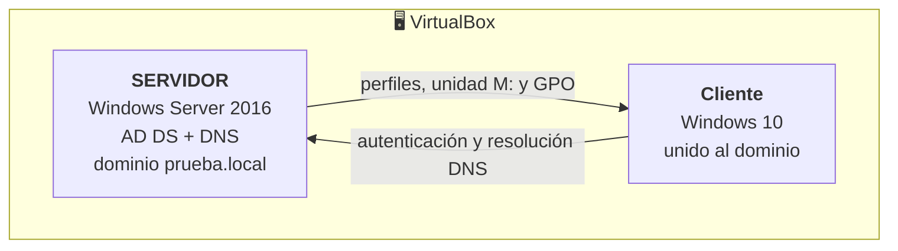

# 🪟 Windows Server 2016

Supuestos prácticos del 3º trimestre de ISO: montar un **dominio de Active Directory** en máquinas virtuales y administrarlo como en un centro educativo, con unidades organizativas por etapa (ESO, Bachillerato y Ciclos), usuarios con restricciones, carpetas personales en red, perfiles móviles y directivas de grupo.

## Laboratorio

## Guías

| # | Guía | Contenido |
|---|---|---|
| 1 | [Instalación y Active Directory](01-instalacion-y-active-directory.md) | VM con Windows Server 2016, rol AD DS, promoción a controlador de dominio, unidades organizativas y degradación |
| 2 | [DNS](02-dns.md) | Zonas de búsqueda directa e inversa, registros A y alias (CNAME) |
| 3 | [Usuarios, carpetas y perfiles](03-usuarios-carpetas-y-perfiles.md) | Usuarios y grupos con horario y equipos permitidos, unión de un cliente al dominio, carpetas personales, unidad de red por *script* de inicio y perfiles móvil, obligatorio y preconfigurado |
| 4 | [Herramientas y directivas de grupo](04-herramientas-y-gpo.md) | Cuotas de disco, visor de eventos, monitor de rendimiento, copias de seguridad y GPO con filtrado de seguridad |

## Conceptos previos

Resumen de los cuestionarios teóricos que abrían la unidad.

### Grupo de trabajo frente a dominio

| | Grupo de trabajo | Dominio |
|---|---|---|
| Administración | Cada equipo gestiona sus propias cuentas | Centralizada en el controlador de dominio |
| Inicio de sesión | Cuenta local de cada equipo | Una cuenta válida en cualquier equipo del dominio |
| Escala | Pocos equipos | Desde decenas a miles de equipos |
| Políticas | Equipo por equipo | GPO aplicadas de forma centralizada |

### Almacenamiento: RAID, NAS y SAN

- **RAID**: combina varios discos para ganar rendimiento, redundancia o ambas cosas. Los niveles más usados en servidores son **RAID 1** (espejo), **RAID 5** (paridad distribuida, mínimo 3 discos, tolera el fallo de uno), **RAID 6** (doble paridad, tolera dos) y **RAID 10** (espejos en bandas, mínimo 4 discos).
- **Modo degradado**: un RAID con redundancia que ha perdido un disco sigue funcionando, pero sin protección hasta que se sustituye y se reconstruye.
- **RAID por hardware** (controladora dedicada, transparente para el sistema) frente a **por software** (lo gestiona el sistema operativo, como `mdadm` en Linux o los espacios de almacenamiento de Windows).
- **NAS**: almacenamiento en red que comparte **ficheros** (SMB, NFS).
- **SAN**: red dedicada que ofrece **bloques** de disco a los servidores (iSCSI, Fibre Channel).

> Un RAID 5 no se puede montar con dos discos: la paridad necesita al menos tres. Y un RAID **no es una copia de seguridad**: protege frente al fallo de un disco, no frente a un borrado, un *ransomware* o un incendio.

### Requisitos de Windows Server 2016

| | Mínimo |
|---|---|
| Procesador | 64 bits a 1,4 GHz |
| Memoria | 512 MB (2 GB con experiencia de escritorio) |
| Disco | 32 GB |
| Red | Adaptador Ethernet de al menos 1 Gb/s |

Algunas características de la versión 2016: **Hyper-V** renovado con máquinas virtuales blindadas, contenedores de Windows, *Nano Server*, mejoras en Active Directory y **PowerShell 5.1**.

### Roles habituales

**AD DS** (servicios de dominio), **DNS**, **DHCP**, **AD CS** (certificados), **AD FS** (federación), servidor de archivos y almacenamiento, **Hyper-V**, **IIS** (servidor web) y **WSUS** (actualizaciones).
