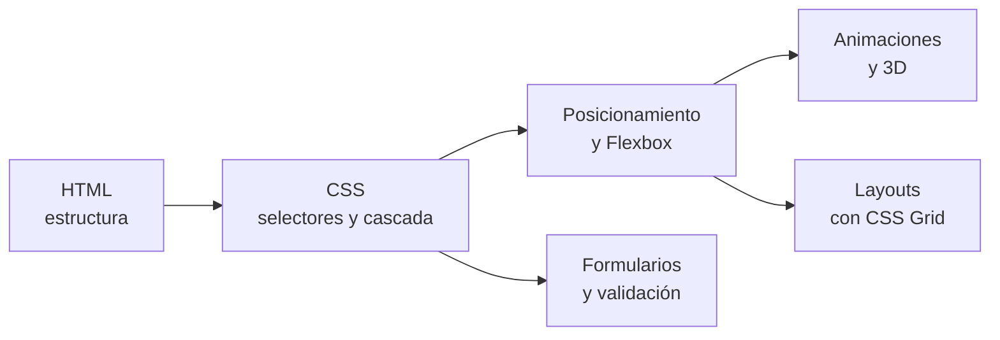

# 🌍 LMSGI · Lenguajes de Marcas y Sistemas de Gestión de Información

Maquetación web con **HTML y CSS** (del primer párrafo a *layouts* completos con Grid y animaciones), documentos **XML** bien formados y un proyecto de **sistemas de gestión** (ERP, CRM y CMS) aplicado a un negocio real.

## Contenido

| Carpeta | Trimestre | Contenido |
|---|---|---|
| [`html-css/`](html-css/) | 1º – 2º | 32 páginas HTML y 4 hojas de estilo, organizadas por tema |
| [`xml/`](xml/README.md) | 2º | 13 documentos XML: corrección de errores y diseño de estructuras |
| [`sistemas-de-gestion/`](sistemas-de-gestion/README.md) | 3º | Análisis de la digitalización de un negocio, Odoo (ERP/CRM) y WordPress (CMS) |

## HTML y CSS

Todas las páginas son estáticas: basta con descargar la carpeta y abrirlas en el navegador.

| Carpeta | Páginas | Qué se practica |
|---|---|---|
| [`01-html-y-css-basico`](html-css/01-html-y-css-basico/) | Primera página, estilos básicos, menú de navegación, dos tablas, horario de clase y comparativa de monitores | Estructura HTML, selectores, `:nth-child`, selectores de atributo, `:hover`, tablas con `rowspan`/`colspan`, degradados |
| [`02-formas-de-aplicar-css`](html-css/02-formas-de-aplicar-css/) | La misma tabla con hoja **externa**, **interna** y **en línea** | Cascada y especificidad: por qué el `:hover` no funciona con estilos en línea |
| [`03-posicionamiento-y-flexbox`](html-css/03-posicionamiento-y-flexbox/) | Cuadrados superpuestos, tarjeta de oferta, tarjeta de contacto y tarjeta horizontal | `position`, Flexbox, pseudoelementos `::before`/`::after`, `transform`, sombras |
| [`04-animaciones`](html-css/04-animaciones/) | Rueda, giro, desplazamiento, escalado al pasar el ratón y bloques con giro 3D | `@keyframes`, `animation`, `transition`, `perspective`, `backface-visibility` |
| [`05-mapa-interactivo`](html-css/05-mapa-interactivo/index.html) | Mapa de España con zonas clicables que abren una página por región | Posicionamiento absoluto sobre una imagen de fondo |
| [`06-formularios`](html-css/06-formularios/) | Catálogo de 36 ejemplos de controles y un formulario reproducido a partir de una imagen | Tipos de `input`, `select`, `textarea`, `fieldset`, validación con `required`, `pattern`, `min`/`max` y `maxlength` |
| [`07-layout-y-grid`](html-css/07-layout-y-grid/) | Réplicas de las webs de cuatro marcas, un currículum y un ejemplo de rejilla anidada | CSS Grid con `grid-template-areas`, rejillas anidadas, SVG en línea, *media queries* |

### Notas

- Las réplicas de webs comerciales (restaurantes y una plataforma de música) son **ejercicios de maquetación** sin ninguna relación con esas marcas. Algunos logotipos van como SVG en línea y el resto de imágenes se enlazan desde webs externas, así que varias ya no cargan porque los servidores bloquean el enlace o han retirado la imagen.
- El **currículum** usa datos ficticios.
- El fondo del mapa interactivo era una imagen con derechos de autor; se ha sustituido por un [mapa libre de Wikimedia Commons](https://commons.wikimedia.org/wiki/File:Spain_location_map.svg) (CC BY-SA 3.0), recolocando los marcadores según sus coordenadas.
- Los ficheros se han renombrado sin espacios ni tildes, con los enlaces internos actualizados.

## XML

Reglas de buena formación, corrección de errores y diseño de documentos: catálogo de discos, tarjeta de visita, libro, ticket de restaurante, correo electrónico y la jerarquía de directorios de Linux. Ver [xml/README.md](xml/README.md).

## Sistemas de gestión

Proyecto en tres entregas sobre un pequeño negocio real (anonimizado): análisis de cómo se gestiona, propuestas de digitalización, implantación de **Odoo** (web, CRM, tienda y citas en línea) e instalación de **WordPress** sobre XAMPP con formulario de contacto. Ver [sistemas-de-gestion/README.md](sistemas-de-gestion/README.md).
