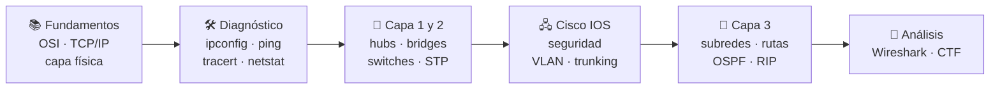

# 🌐 PAR · Planificación y Administración de Redes

Del modelo OSI a la configuración de switches y routers Cisco: fundamentos de redes, diagnóstico desde la línea de órdenes, redes virtuales, simulación en **Cisco Packet Tracer**, VLAN, enrutamiento estático y dinámico, y análisis de tráfico con **Wireshark**.

## Documentación

| Guía | Contenido | Trimestre |
|---|---|---|
| [Fundamentos de redes](fundamentos-de-redes.md) | Tipos de redes, topologías, OSI y TCP/IP, capa física (modulación, medios, CRC, Hamming), protocolos y puertos, comparativa de operadores y presupuesto de un aula | 1º – 2º |
| [Herramientas y VirtualBox](herramientas-y-virtualbox.md) | `ipconfig`, `ping` (y cálculo de la MTU), `tracert`, `netstat`, `arp`; modos de red de VirtualBox; IP estática con netplan en Ubuntu Server | 2º |
| [Packet Tracer](packet-tracer.md) | Hubs, bridges y switches en modo simulación: colisiones, ARP, tabla CAM, STP y subredes /26 | 2º – 3º |
| [Cisco IOS](cisco-ios.md) | Modos de la CLI, órdenes `show`, acceso por consola y Telnet, contraseñas, banner, puertos, VLAN y *trunking* | 3º |
| [Enrutamiento](enrutamiento.md) | Tres routers con enlaces serie: rutas estáticas, OSPF, RIP, coste, `bandwidth` y distancia administrativa | 3º |
| [Wireshark](wireshark.md) | Captura, navegación, protocolos capa a capa, filtros de visualización y estadísticas | 3º |
| [CTF "Tomar la bandera"](ctf-tomar-la-bandera.md) | Reto resuelto: descompilación de Java, Base64, FTP y análisis de SMTP | 3º |

## Recorrido

## Aspectos destacados

- **Chuleta de Cisco IOS** con todas las órdenes usadas en las prácticas, ordenadas por tarea.
- **Enrutamiento comparado**: la misma topología con rutas estáticas, OSPF y RIP, demostrando que OSPF tiene en cuenta el ancho de banda y RIP solo los saltos.
- **Wireshark**: resumen de una práctica de 152 preguntas en forma de tabla de filtros reutilizable.
- **CTF superado** con bonificación en la nota: ingeniería inversa de un `.jar`, Base64, FTP y reconstrucción de un correo SMTP a partir de una captura.
- **Cálculos comprobados**: subredes, coste OSPF, código Hamming y MTU.
