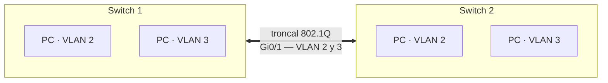

# 🖧 Cisco IOS: switches, seguridad y VLAN

Chuleta de las órdenes de Cisco IOS usadas en las prácticas 8, 9 y 10 con switches en Packet Tracer. Las contraseñas y textos de los ejemplos son genéricos.

## Índice

1. [Modos de la CLI](#1-modos-de-la-cli)
2. [Órdenes básicas y show](#2-órdenes-básicas-y-show)
3. [Acceso por consola y por Telnet](#3-acceso-por-consola-y-por-telnet)
4. [Seguridad del modo privilegiado y banner](#4-seguridad-del-modo-privilegiado-y-banner)
5. [Configuración de puertos](#5-configuración-de-puertos)
6. [VLAN](#6-vlan)
7. [Trunking](#7-trunking)

## 1. Modos de la CLI

| Prompt | Modo | Se entra con | Se sale con |
|---|---|---|---|
| `Switch>` | EXEC de usuario (solo consulta) | Al conectar | `exit` |
| `Switch#` | EXEC privilegiado | `enable` | `disable` |
| `Switch(config)#` | Configuración global | `configure terminal` | `exit` / `end` |
| `Switch(config-if)#` | Interfaz | `interface fastEthernet 0/1` | `exit` |
| `Switch(config-if-range)#` | Rango de interfaces | `interface range fa0/1 - 10` | `exit` |
| `Switch(config-line)#` | Línea (consola, VTY) | `line console 0` / `line vty 0 15` | `exit` |
| `Switch(config-vlan)#` | VLAN | `vlan 2` | `exit` |

`?` muestra las órdenes disponibles en cada modo (y los parámetros tras una orden: `show ?`, `speed ?`). La lista es distinta en modo usuario y en privilegiado.

## 2. Órdenes básicas y show

```text
Switch> reload                      ! en modo usuario no existe: intenta resolverla como nombre de equipo
Switch# reload                      ! reinicia el switch (pide confirmación)

Switch(config)# no ip domain-lookup ! evita la espera de "Translating..." al teclear mal una orden
Switch(config)# hostname SW1        ! cambia el nombre del equipo
```

| Orden | Muestra |
|---|---|
| `show clock` | Fecha y hora del equipo |
| `show mac-address-table` | Tabla CAM: MAC aprendidas, VLAN y puerto |
| `show running-config` | Configuración en ejecución |
| `show version` | Modelo, versión de IOS, memoria y tiempo encendido |
| `show processes` | Procesos y uso de CPU |
| `show interfaces` | Estado y estadísticas de cada puerto |
| `show spanning-tree` | Estado de STP |

<a id="stp"></a>
**STP**: en una topología con bucles, `show spanning-tree` muestra el puente raíz y el rol de cada puerto. Todos quedan en reenvío (`FWD`) salvo el que rompe el bucle, que aparece como alternativo y bloqueado:

```text
Interface        Role Sts Cost      Prio.Nbr Type
---------------- ---- --- --------- -------- ----
Fa0/1            Altn BLK 19        128.1    P2p
Fa1/1            Desg FWD 19        128.2    P2p
Fa4/1            Root FWD 19        128.5    Shr
```

## 3. Acceso por consola y por Telnet

**Consola**: cable de consola entre el puerto RS-232 del PC y el puerto *Console* del switch; en el PC, *Desktop › Terminal*.

```text
Switch(config)# line console 0
Switch(config-line)# password <contraseña>
Switch(config-line)# login
Switch(config-line)# end
```

**Telnet**: el switch necesita una IP de gestión en la VLAN 1, un usuario local y las líneas virtuales (VTY) configuradas. El PC se conecta con cable de red y una IP de la misma red.

```text
Switch(config)# username admin privilege 15 secret <contraseña>
Switch(config)# line vty 0 15
Switch(config-line)# login local
Switch(config-line)# exit
Switch(config)# interface vlan 1
Switch(config-if)# ip address 192.168.1.3 255.255.255.0
Switch(config-if)# no shutdown
```

```text
C:\> telnet 192.168.1.3
```

> Telnet viaja en texto plano, contraseñas incluidas. En un entorno real se usa **SSH** (`ip domain-name`, `crypto key generate rsa` y `transport input ssh` en las VTY).

## 4. Seguridad del modo privilegiado y banner

```text
Switch(config)# enable password <contraseña>   ! se guarda en claro en la configuración
Switch(config)# no enable password

Switch(config)# enable secret <contraseña>     ! se guarda como hash (tipo 5)
Switch(config)# no enable secret

Switch(config)# service password-encryption    ! ofusca el resto de contraseñas en claro
```

Con `show running-config` se comprueba la diferencia: `enable password` aparece legible y `enable secret 5 $1$…` no. Si existen las dos, prevalece `enable secret`.

**Mensaje del día** (se muestra al conectar al switch):

```text
Switch(config)# banner motd @ Acceso restringido al personal autorizado @
Switch(config)# no banner motd
```

## 5. Configuración de puertos

```text
Switch(config)# interface fastEthernet 0/1
Switch(config-if)# speed 100
Switch(config-if)# duplex full
Switch(config-if)# description Enlace con el PC de administración

Switch(config)# interface range fastEthernet 0/11 - 20
Switch(config-if-range)# description Puertos del aula

Switch# show interfaces fastEthernet 0/1      ! velocidad, dúplex y descripción
Switch# show interfaces description           ! estado y descripción de todos los puertos
```

**Deshabilitar los puertos que no se usan** es una medida básica de seguridad: nadie puede conectarse a ellos.

```text
Switch(config)# interface fastEthernet 0/3
Switch(config-if)# shutdown                   ! el PC conectado deja de tener conexión
Switch(config-if)# no shutdown               ! se restaura
```

## 6. VLAN

Una VLAN separa lógicamente un switch en varias redes: los equipos de VLAN distintas no se comunican sin un router, aunque estén en el mismo switch.

```text
Switch(config)# vlan 2
Switch(config-vlan)# name amarillo
Switch(config-vlan)# vlan 3
Switch(config-vlan)# name verde
Switch(config-vlan)# exit

Switch(config)# interface range fastEthernet 0/1 - 10
Switch(config-if-range)# switchport mode access
Switch(config-if-range)# switchport access vlan 2
Switch(config-if-range)# interface range fastEthernet 0/11 - 20
Switch(config-if-range)# switchport mode access
Switch(config-if-range)# switchport access vlan 3

Switch# show vlan brief
```

Resultado de la práctica: los PC de la VLAN 2 se comunican entre sí, igual que los de la VLAN 3, pero un equipo de una VLAN no alcanza a los de otra.

## 7. Trunking

Con dos switches y las mismas VLAN en ambos, haría falta un cable por VLAN para unirlos. Un **enlace troncal** (802.1Q) transporta todas las VLAN por un solo cable, etiquetando cada trama con su VLAN.



```text
Switch# show interfaces gigabitEthernet 0/1 switchport   ! modo administrativo y operativo
Switch# show interfaces trunk                            ! vacío: todavía no hay troncal

Switch(config)# interface gigabitEthernet 0/1
Switch(config-if)# switchport mode dynamic desirable      ! o bien: switchport mode trunk

Switch# show interfaces trunk                            ! Gi0/1 ya aparece como troncal
```

Basta con configurarlo en un extremo: el otro está por defecto en *dynamic auto* y **DTP** negocia el troncal. Con el troncal activo, los PC de la misma VLAN se comunican aunque estén en switches distintos.
