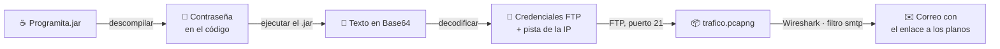

# 🚩 CTF "Tomar la bandera"

Reto de clase ambientado en el universo Marvel: **descubrir quién filtraba información confidencial de S.H.I.E.L.D.** siguiendo una cadena de pistas que combina ingeniería inversa, codificación, FTP y análisis de tráfico.

**Resultado**: ✅ reto superado, con la "insignia de honor" del enunciado y una bonificación en la nota final del módulo.

> 🔒 La contraseña, las credenciales y las direcciones del laboratorio se han omitido.

## Cadena del reto



## 1. El programa Java

La pista inicial era un fichero `Programita.jar` que pedía una contraseña.

1. Para ejecutarlo hace falta Java (se instaló el JDK; la asociación de ficheros `.jar` en Windows se reparó con *Jarfix*).
2. Sin la contraseña no hacía nada, así que se **descompiló** para leer su código fuente. En la práctica se usó un descompilador en línea; alternativas locales son JD-GUI o CFR:

   ```bash
   java -jar cfr.jar Programita.jar --outputdir fuente/
   ```

3. Buscando en el código la lógica de envío (`send`) aparecía la contraseña **escrita en claro** en una comparación. Al introducirla, el programa mostraba un texto aparentemente sin sentido.

## 2. Decodificar la pista

Un identificador de cifrados (dCode) reconoció el texto como **Base64**. Decodificado, contenía un usuario y una contraseña, y la pista *"la primera disponible de la red"*: la **primera dirección de host** de la red en la que estaba el equipo.

```bash
echo '<texto>' | base64 -d
```

## 3. Descargar la captura por FTP

Con las credenciales y la IP deducida, conexión al servidor FTP (puerto 21) con FileZilla, que contenía un único fichero: `trafico.pcapng`, una captura de Wireshark.

## 4. Analizar el tráfico

Como la pista hablaba de un correo, se filtró por el protocolo de envío de correo:

```text
smtp
```

*Clic derecho › Seguir › Flujo TCP* mostraba la conversación completa con el servidor de correo, **en texto plano**. El mensaje incluía un enlace a los planos que buscaba el filtrador: fin del reto.

## Variantes planteadas

**¿Y si no se conociera la IP del servidor?** Habría que descubrir los equipos activos de la red: revisar la caché con `arp -a` o hacer un barrido de *ping* con Nmap (o su interfaz gráfica, Zenmap):

```bash
nmap -sn 10.0.0.0/16
```

**¿Y si la captura no tuviera permiso de lectura?** Con privilegios de administrador se toma la propiedad del fichero o se edita su ACL (*Propiedades › Seguridad*) para quitar la denegación de lectura. En Linux, `sudo chmod` / `sudo chown`.

**¿Y si el correo se hubiera enviado con TLS?** El contenido viajaría cifrado y Wireshark solo vería el establecimiento de la sesión. Para leerlo haría falta disponer de las claves de sesión, algo que solo es posible si se controla uno de los extremos.

**¿Y sin interfaz gráfica?** Todo se puede hacer desde la terminal (en la práctica, en Linux):

```bash
ftp <ip-del-servidor>          # usuario y contraseña de la pista
ftp> ls
ftp> get trafico.pcapng
ftp> bye

sudo apt install tshark
tshark -r trafico.pcapng -Y smtp                       # solo el tráfico SMTP
tshark -r trafico.pcapng -q -z follow,tcp,ascii,0      # reconstruir la conversación (flujo 0)
```

## Lecciones

- **Un secreto dentro de un programa no es un secreto**: el código de Java (o .NET) se descompila con facilidad.
- **Base64 es una codificación, no un cifrado**: cualquiera puede revertirla.
- **FTP y SMTP sin TLS** transmiten credenciales y contenido en claro: basta con capturar el tráfico para leerlos.
