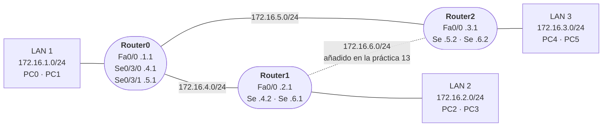

# 🧭 Enrutamiento: rutas estáticas, OSPF y RIP

Prácticas 12 y 13 en Packet Tracer: interconectar tres LAN con tres routers mediante enlaces serie, primero con **rutas estáticas** y después con los protocolos dinámicos **OSPF** y **RIP**, comparando cómo elige cada uno el camino.

## Topología



- Cada router lleva un módulo **WIC-2T** con dos puertos serie.
- Cada PC usa como **puerta de enlace** la IP de la interfaz FastEthernet del router de su LAN (`172.16.X.1`).

## 1. Interfaces

```text
Router(config)# interface fastEthernet 0/0
Router(config-if)# ip address 172.16.1.1 255.255.255.0
Router(config-if)# no shutdown
Router(config-if)# interface serial 0/3/0
Router(config-if)# ip address 172.16.4.1 255.255.255.0
Router(config-if)# no shutdown
Router(config-if)# interface serial 0/3/1
Router(config-if)# ip address 172.16.5.1 255.255.255.0
Router(config-if)# no shutdown

Router# show ip interface brief
```

| Estado en `show ip interface brief` | Significado |
|---|---|
| `up` / `up` | Interfaz activa y con enlace |
| `administratively down` / `down` | Desactivada con `shutdown` |
| `down` / `down` | Activada, pero sin enlace: por ejemplo, **al quitar el cable** |

`show version` muestra el modelo, la versión de IOS y de la ROM, la memoria y el número de interfaces.

## 2. Rutas estáticas

Cada router conoce sus redes directamente conectadas; para las demás hay que indicarle el **siguiente salto**. En la práctica se añadieron desde la pestaña *Config › Routing › Static* de Packet Tracer, que genera estas órdenes:

```text
! Router0
ip route 172.16.2.0 255.255.255.0 172.16.4.2
ip route 172.16.3.0 255.255.255.0 172.16.5.2
! Router1
ip route 172.16.1.0 255.255.255.0 172.16.4.1
ip route 172.16.3.0 255.255.255.0 172.16.4.1
! Router2
ip route 172.16.1.0 255.255.255.0 172.16.5.1
ip route 172.16.2.0 255.255.255.0 172.16.5.1
```

Comprobación:

```text
Router# show ip route          ! C = conectada, S = estática
Router# show running-config
C:\> tracert 172.16.3.2        ! desde PC0: pasa por Router0 y Router2
C:\> arp -a                    ! en el PC: solo aparece la MAC de su puerta de enlace
C:\> arp -d                    ! vaciar la caché ARP y repetir la prueba
```

## 3. OSPF

Protocolo de **estado de enlace**: cada router conoce la topología completa y calcula el camino de **menor coste** con el algoritmo de Dijkstra.

```text
Router(config)# router ospf 1
Router(config-router)# network 0.0.0.0 255.255.255.255 area 0
```

La orden anterior activa OSPF en **todas** las interfaces, en el área 0. Lo más fino es anunciar solo las redes propias con su *wildcard*: `network 172.16.0.0 0.0.255.255 area 0`.

**Coste** = 10⁸ / ancho de banda (bps), con un mínimo de 1:

| Interfaz | Ancho de banda | Coste OSPF |
|---|---|---:|
| FastEthernet | 100 Mbit/s | 1 |
| Serie (por defecto) | 1544 kbit/s | 64 |
| Serie con `bandwidth 1000` | 1000 kbit/s | 100 |

- **Ruta más corta**: al añadir el enlace Router1–Router2, el tráfico entre LAN 2 y LAN 3 pasa a usarlo directamente.
- **La orden `bandwidth`** (en kbit/s) no cambia la velocidad real del enlace, pero sí el coste que calcula OSPF. Rebajando el ancho de banda de un enlace se obliga a OSPF a rodear por otro camino:

  ```text
  Router(config)# interface serial 0/3/0
  Router(config-if)# bandwidth 1
  Router(config-if)# no bandwidth       ! vuelve al valor por defecto
  ```

- En la tabla de rutas, cada ruta OSPF muestra `[110/coste]`. Por ejemplo, `O 172.16.2.0 [110/165] via 172.16.5.1` = distancia administrativa 110 y coste 165 (100 + 64 + 1).

## 4. RIP

Protocolo de **vector distancia**: la métrica es el **número de saltos** (máximo 15).

```text
Router(config)# no ip route 172.16.3.0 255.255.255.0 172.16.5.2   ! se quitan las estáticas
Router(config)# router rip
Router(config-router)# network 172.16.0.0
```

- Funciona igual de bien con el bucle que forma el enlace Router1–Router2.
- **RIP ignora `bandwidth`**: aunque un enlace se configure a 1 kbit/s y otro a 1000 kbit/s, RIP elige el de menos saltos, sea o no el más lento. Esa es la gran diferencia práctica con OSPF.

## 5. Forzar una ruta: distancia administrativa

Cuando varias fuentes conocen la misma red, el router elige la de menor **distancia administrativa**:

| Origen de la ruta | Distancia administrativa |
|---|---:|
| Conectada | 0 |
| Estática | 1 |
| OSPF | 110 |
| RIP | 120 |

- Una **ruta estática** se impone a OSPF y a RIP, así que sirve para forzar un camino concreto (por ejemplo, que la ida use una ruta fija y la vuelta la que calcule OSPF):

  ```text
  Router(config)# ip route 172.16.3.0 255.255.255.0 172.16.4.1
  ```

- Añadiendo una distancia administrativa mayor que la del protocolo se convierte en una **ruta flotante**: solo se usa si la ruta dinámica desaparece, como respaldo.

  ```text
  Router(config)# ip route 172.16.3.0 255.255.255.0 172.16.4.1 130
  ```
