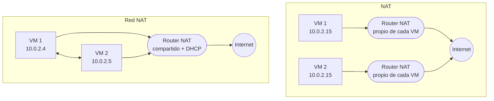

# 🛠️ Herramientas de red y redes en VirtualBox

Prácticas del 2º trimestre: diagnóstico de red desde la línea de órdenes de Windows y configuración de los distintos modos de red de VirtualBox con Ubuntu Desktop y Ubuntu Server.

## 1. Órdenes de diagnóstico en Windows

### ipconfig

| Orden | Uso |
|---|---|
| `ipconfig` | IP, máscara y puerta de enlace de cada adaptador |
| `ipconfig /all` | Añade MAC, servidores DNS, servidor DHCP y concesión |
| `ipconfig /release` y `/renew` | Liberar y renovar la IP obtenida por DHCP |
| `ipconfig /displaydns` y `/flushdns` | Ver y vaciar la caché DNS |

Una de las preguntas de la práctica era si los servidores DNS y DHCP estaban en la misma subred que el equipo: se comprueba aplicando la máscara a sus direcciones. Un DNS público como `8.8.8.8` nunca lo está, y se llega a él a través de la puerta de enlace.

### ping

Envía mensajes **ICMP Echo Request** (tipo 8) y espera los **Echo Reply** (tipo 0) para medir el tiempo de ida y vuelta y la pérdida de paquetes.

| Opción | Uso |
|---|---|
| `-t` | Repetir hasta interrumpir con <kbd>Ctrl</kbd>+<kbd>C</kbd> |
| `-n N` | Enviar N solicitudes |
| `-l tamaño` | Tamaño de los datos enviados |
| `-f` | Activar *Don't Fragment* (no fragmentar) |
| `-i TTL` | Tiempo de vida inicial |

**Averiguar la MTU del camino**: se aumenta el tamaño con `-f -l` hasta que aparece *"Es necesario fragmentar el paquete, pero se especificó DF"*.

```bat
ping -f -l 1464 www.google.es   REM responde
ping -f -l 1465 www.google.es   REM "Es necesario fragmentar el paquete..."
```

El máximo sin fragmentar fue **1464 bytes** de datos. Sumando las cabeceras ICMP (8 bytes) e IP (20 bytes) da una MTU de **1492 bytes**, la típica de las conexiones PPPoE, algo menor que los 1500 bytes de Ethernet.

### tracert

Descubre los routers del camino enviando paquetes con **TTL 1, 2, 3…**: cada router que agota el TTL devuelve un ICMP *Time Exceeded* (tipo 11) y se identifica. Un `*` indica que ese salto no respondió a tiempo, lo que suele deberse a routers que filtran ICMP, no a un fallo de la ruta.

### netstat, route y arp

| Orden | Uso |
|---|---|
| `netstat -a -n` | Conexiones activas y puertos en escucha, en formato numérico |
| `netstat -e` y `netstat -s` | Estadísticas de Ethernet y por protocolo (IP, ICMP, TCP, UDP) |
| `netstat -r` o `route print` | Tabla de enrutamiento |
| `arp -a` | Caché ARP: correspondencias IP ↔ MAC aprendidas |
| `arp -d` / `arp -s` | Borrar o añadir entradas (requiere permisos de administrador) |

**Cómo elige la ruta el sistema**: aplica la máscara de cada fila de la tabla a la IP de destino, se queda con las que coinciden y, de ellas, con la de **máscara más larga** (la más específica). Si hay empate, gana la de **menor métrica**.

## 2. Modos de red de VirtualBox



| Modo | VM ↔ VM | VM ↔ anfitrión | VM → Internet | Direcciones |
|---|:---:|:---:|:---:|---|
| **NAT** | ❌ | Solo con redirección de puertos | ✅ | Cada VM tiene su propia red privada: todas reciben `10.0.2.15` |
| **Red NAT** | ✅ | Solo con redirección de puertos | ✅ | DHCP de VirtualBox en una red compartida (`10.0.2.0/24`) |
| **Adaptador puente** | ✅ | ✅ | ✅ | La VM aparece en la red física y obtiene IP de su router |
| **Solo anfitrión** | ✅ | ✅ | ❌ | Red privada con el anfitrión (`192.168.56.0/24` por defecto) |
| **Red interna** | ✅ | ❌ | ❌ | Solo entre las VM conectadas a la misma red interna |

**Lo que se comprobó en la práctica**, con dos Ubuntu Desktop clonados:

- **Clonación**: al clonar hay que **generar nuevas direcciones MAC**; si no, las dos VM tienen la misma MAC y chocan en modos como el puente. Un clon **completo** copia el disco entero; uno **enlazado** comparte el disco del original y ocupa mucho menos.
- **NAT**: las dos VM tienen la IP `10.0.2.15`. Un `ping` entre ellas "funciona", pero en realidad cada una se responde a sí misma; al apagar una de ellas, la otra sigue respondiendo.
- **Red NAT**: tras crear la red en *Herramientas › Redes NAT* con DHCP activo, cada VM recibe una IP distinta y se comunican entre sí.
- **Puente** y **solo anfitrión**: cada VM recibe IP de la red correspondiente y se comunican. En solo anfitrión se activó el **modo promiscuo** (*Permitir todo*) en el adaptador.

Para ver la configuración en Ubuntu se instaló `net-tools` (`ifconfig`); la alternativa moderna, ya incluida, es `ip a`.

## 3. Ubuntu Server con IP estática (netplan)

Dos Ubuntu Server 22.04 (con **OpenSSH** instalado durante la instalación) conectados por una red **solo anfitrión** como segundo adaptador. La IP se fija en netplan:

```bash
cd /etc/netplan
ls
sudo nano 00-installer-config.yaml
```

```yaml
# /etc/netplan/00-installer-config.yaml (servidor 1)
network:
  version: 2
  ethernets:
    enp0s3:            # adaptador 1: NAT, salida a Internet
      dhcp4: true
    enp0s8:            # adaptador 2: solo anfitrión
      addresses:
        - 192.168.100.10/24
```

```bash
sudo netplan apply
ip a                        # comprobar la nueva IP
ping 192.168.100.11         # el otro servidor
ping www.google.es          # salida a Internet por el adaptador NAT
```

Con **adaptador puente**, la IP estática tiene que pertenecer a la red física e incluir puerta de enlace y DNS:

```yaml
network:
  version: 2
  ethernets:
    enp0s3:
      addresses:
        - 192.168.1.50/24
      routes:
        - to: default
          via: 192.168.1.1
      nameservers:
        addresses: [1.1.1.1, 8.8.8.8]
```

Puertos TCP y UDP en escucha en los servidores:

```bash
netstat -ltn    # TCP en escucha (el 22 de SSH, por ejemplo)
netstat -lun    # UDP en escucha
ss -tuln        # alternativa moderna a netstat
```

> Las direcciones de los ejemplos son genéricas; la red del laboratorio seguía el mismo esquema.
