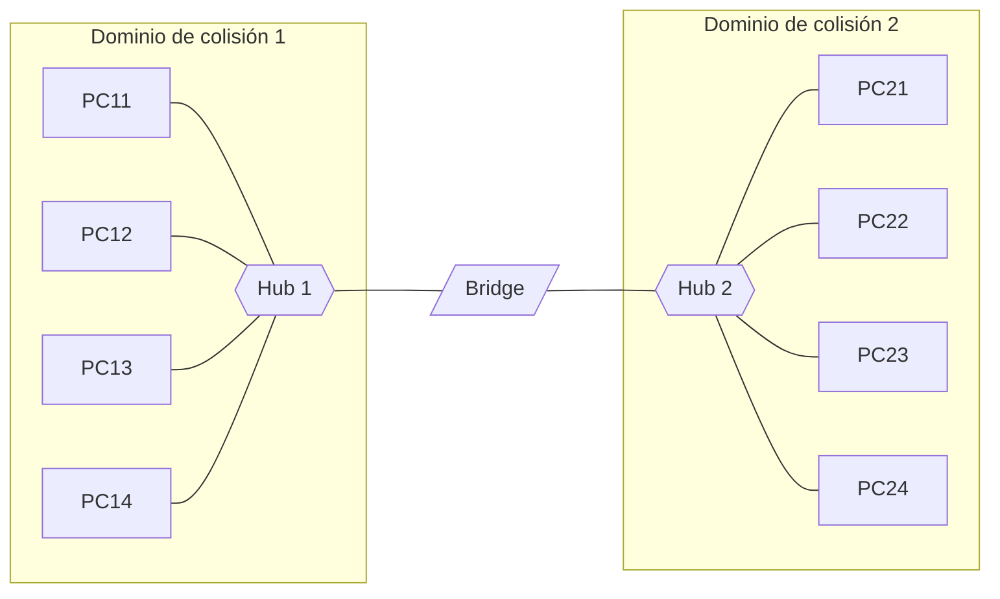

# 🔌 Packet Tracer: hubs, bridges, switches y subredes

Prácticas con **Cisco Packet Tracer** del 2º y 3º trimestre para ver en el modo simulación cómo viajan las tramas por la red y qué cambia al sustituir hubs por bridges y switches.

## 1. Red con un hub

Cuatro PC (`PC01`–`PC04`, `192.168.1.1`–`192.168.1.4/24`) conectados a un hub.

- **Sin IP** los PC no pueden enviarse nada; con la IP y la máscara configuradas, el mensaje simple (el sobre) llega a su destino.
- En **modo simulación** (*Capture/Forward*) se ve que el hub **reenvía la trama por todos sus puertos**: solo la acepta el destinatario, el resto la descarta (✖).
- **Contenido del paquete** (*Outbound PDU Details*):
  - **Capa 3**: IP de origen y destino, TTL y campo *Protocol* = `0x1`, que corresponde a **ICMP** (el mensaje de `ping`).
  - **Capa 2**: MAC de origen y destino de la trama Ethernet.
- **Colisiones**: enviando a la vez de PC01 a PC02 y de PC03 a PC04, las tramas chocan en el hub y ninguna llega: todos los puertos de un hub forman **un único dominio de colisión**.

## 2. Dos hubs y un bridge



1. **Dos hubs enlazados** con PC11–PC14 en `192.168.1.0/24` y PC21–PC24 en `192.168.2.0/24`: el `ping` entre ambos lados falla porque están en **redes distintas** y no hay router. Al pasar el segundo grupo a `192.168.1.5`–`192.168.1.8`, todos se comunican.
2. **Cableado**: cable **directo** entre dispositivos de distinto tipo (PC–hub) y **cruzado** entre dispositivos del mismo tipo (hub–hub, switch–switch, PC–PC). Hoy casi todos los puertos tienen **Auto-MDIX** y detectan el tipo solos.
3. **Bridge** entre los hubs: aprende en qué lado está cada MAC y **solo reenvía al otro lado las tramas cuyo destino está allí**. Divide la red en dos dominios de colisión: PC11 → PC13 y PC21 → PC23 pueden transmitir a la vez sin chocar.
4. Cuando el bridge aún no conoce el destino, la petición **ARP** (difusión) sí cruza al otro lado; con la respuesta aprende la ubicación de la MAC.

La herramienta de dibujo de Packet Tracer se usó para rotular zonas de la topología (secretaría, dirección).

## 3. Switch, ARP y tabla CAM

Cuatro PC conectados a un switch genérico, con `ping` desde el *Command Prompt* de cada PC.

- **ARP**: antes del primer ICMP, el origen envía una petición ARP preguntando por la MAC de la IP de destino. La trama va a la dirección de **difusión** (`FFFF.FFFF.FFFF`) y, dentro del mensaje ARP, el campo de MAC de destino va a ceros (`0000.0000.0000`) porque es justo lo que se desconoce. El destinatario responde y los dos guardan la correspondencia IP ↔ MAC en su caché.
- **Tabla CAM**: el switch aprende la MAC de origen de cada trama y el puerto por el que llega. Se consulta desde su CLI:

  ```text
  Switch# show mac-address-table
  ```

  Vacía al arrancar; tras un `ping` entre dos PC tiene dos entradas, y una tercera en cuanto habla otro equipo. Mientras el destino esté en la tabla, **no hace falta una nueva difusión**.
- **Sin colisiones**: cada puerto del switch es su propio dominio de colisión y trabaja en *full duplex*. Enviando a la vez 11→12, 12→13, 13→14 y 14→11 no se pierde nada: el switch almacena en **búfer** las tramas que no puede reenviar en ese momento.
- El **hub** no participa en ARP ni tiene tabla: trabaja en la **capa 1**, repitiendo bits, mientras que el switch trabaja en la **capa 2** con direcciones MAC.

## 4. Bucles y STP

Tres switches conectados en triángulo con un PC en cada uno:

- El **Spanning Tree Protocol** detecta el bucle y **bloquea un puerto** (en ámbar en Packet Tracer). Sin STP, las difusiones darían vueltas sin fin: una **tormenta de difusión**.
- El estado se consulta con `show spanning-tree` (puerto raíz, designados y el que queda como `Altn BLK`). Ver la [chuleta de Cisco IOS](cisco-ios.md#stp).
- Con **hubs** en bucle no hay STP que lo evite: en una red real se produciría una tormenta de difusión. Por eso las redes con redundancia se construyen con switches.

## 5. Subredes: 192.168.15.10/26

| Dato | Valor |
|---|---|
| Máscara | `255.255.255.192` (/26) |
| Bits de red / subred / host | 24 / 2 / 6 |
| Subredes y hosts por subred | 2² = 4 subredes de 2⁶ − 2 = 62 hosts |
| Subred de `192.168.15.10` | `192.168.15.0/26` (difusión `.63`) |

| Subred | Red | Primer host | Último host | Difusión | PC del ejercicio |
|---|---|---|---|---|---|
| 00 | 192.168.15.0 | .1 | .62 | .63 | PC0 `.1`, PC1 `.2` |
| 01 | 192.168.15.64 | .65 | .126 | .127 | PC2 `.65`, PC3 `.66` |
| 10 | 192.168.15.128 | .129 | .190 | .191 | PC4 `.129`, PC5 `.130` |
| 11 | 192.168.15.192 | .193 | .254 | .255 | PC6 `.193`, PC7 `.194` |

En Packet Tracer, con los 8 PC en un mismo hub (y después en un switch, añadiendo módulos de puertos), los equipos de **la misma subred se comunican** y los de **subredes distintas no**: aunque compartan el medio físico, cada uno considera que el otro está fuera de su red y necesitaría un router para alcanzarlo.

> La clase de una dirección IPv4 la determina su primer octeto (192 → clase C), no el prefijo; con CIDR, el `/26` es simplemente la longitud de la máscara.
