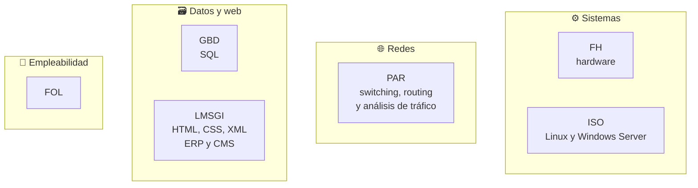

# 1️⃣ Primer curso de ASIR · 2023-2024

Los seis módulos del primer curso, con el código, las prácticas y los apuntes de cada uno. Todo se trabajó en tres trimestres y casi siempre sobre máquinas virtuales o simuladores.

## Módulos

| Módulo | Código | Qué incluye |
|---|---|---|
| [🖥️ FH · Fundamentos de Hardware](FH/README.md) | 0371 | Arquitectura de computadores, componentes, montaje de PC, diagnóstico, SAI, RAID 5 y diseño de un CPD |
| [🗃️ GBD · Gestión de Bases de Datos](GBD/README.md) | 0372 | 25 scripts SQL para MySQL: modelo E/R, consultas, subconsultas, vistas, funciones, procedimientos y disparadores |
| [💻 ISO · Implantación de Sistemas Operativos](ISO/README.md) | 0369 | Virtualización y arranque dual, terminal de Linux, 10 *shell scripts* y un dominio de Active Directory con Windows Server 2016 |
| [🌍 LMSGI · Lenguajes de Marcas y Sistemas de Gestión de Información](LMSGI/README.md) | 0373 | 32 páginas HTML/CSS, 13 documentos XML y un proyecto con Odoo y WordPress |
| [🌐 PAR · Planificación y Administración de Redes](PAR/README.md) | 0370 | Packet Tracer, Cisco IOS, VLAN, OSPF y RIP, Wireshark y un CTF |
| [💼 FOL · Formación y Orientación Laboral](FOL/README.md) | 0380 | Prevención de riesgos laborales y legislación laboral |

## El curso por trimestres

| | 1º trimestre | 2º trimestre | 3º trimestre |
|---|---|---|---|
| **FH** | Von Neumann y ciclo de instrucción | Placa base, fuente, cajas, discos y periféricos | Montaje de PC, diagnóstico, SAI, RAID y CPD |
| **GBD** | Diseño E/R, DDL y consultas | `LEFT JOIN`, subconsultas, vistas y transacciones | Funciones, procedimientos y disparadores |
| **ISO** | VirtualBox, arranque dual y licencias | Terminal de Linux y *shell scripts* | Windows Server 2016 y Active Directory |
| **LMSGI** | HTML, CSS, Flexbox y animaciones | Formularios, CSS Grid y XML | Odoo y WordPress |
| **PAR** | Tipos de redes, OSI y presupuesto de un aula | Capa física, comandos de red, VirtualBox y Packet Tracer | Switches, VLAN, enrutamiento, Wireshark y CTF |
| **FOL** | Prevención de riesgos laborales | Contrato, jornada y nómina | Extinción del contrato y Seguridad Social |

## Código del curso

| Tipo | Ficheros | Dónde |
|---|---:|---|
| SQL (MySQL) | 25 | [GBD](GBD/README.md) |
| Bash | 10 | [ISO › scripts](ISO/linux/scripts/README.md) |
| HTML + CSS | 32 + 4 | [LMSGI › html-css](LMSGI/html-css/) |
| XML | 13 | [LMSGI › xml](LMSGI/xml/README.md) |
