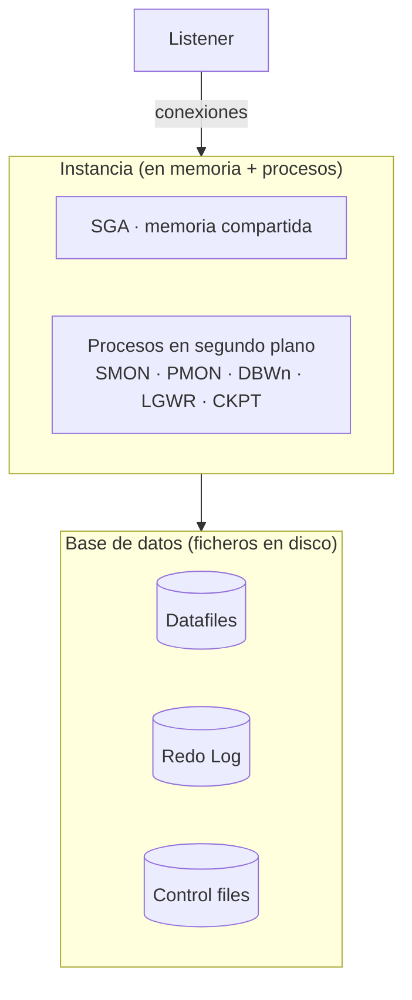
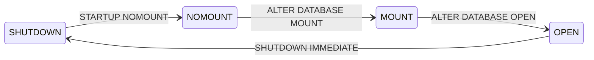

# 🗄️ ASGBD · Administración de Sistemas Gestores de Bases de Datos

Administración de **Oracle Database 19c**: arquitectura del SGBD, ciclo de vida de la instancia, gestión de **tablespaces**, y seguridad con **usuarios, privilegios, perfiles y roles**. Incluye una introducción a las bases de datos **NoSQL**.

| Fichero | Contenido |
|---|---|
| [`chuleta-administracion-oracle.sql`](chuleta-administracion-oracle.sql) | Chuleta de órdenes de administración: conexión, arranque, tablespaces, usuarios, privilegios, roles y perfiles |
| [`usuarios-perfiles-roles.sql`](usuarios-perfiles-roles.sql) | Soluciones SQL de la práctica de usuarios, privilegios, perfiles y roles |

## Arquitectura de Oracle



- **Instancia** = la SGA (memoria compartida) más los procesos en segundo plano. Es lo que se arranca y se para.
- **Base de datos** = los ficheros en disco (*datafiles*, *redo log*, *control files*).
- **Listener**: proceso que acepta las conexiones de los clientes.
- **Interfaces de gestión**: `SQL*Plus` (línea de comandos), SQL Developer, DataGrip, Enterprise Manager…

## Ciclo de vida de la instancia



| Estado | Qué hay cargado | Para qué sirve |
|---|---|---|
| **SHUTDOWN** | Nada | Base de datos cerrada |
| **NOMOUNT** | Instancia en memoria (lee el SPFILE) | Crear la BD o recrear el control file |
| **MOUNT** | + ficheros de control | Renombrar datafiles, modo ARCHIVELOG, recuperación |
| **OPEN** | + datafiles y redo log | Funcionamiento normal |

El **SPFILE** guarda los parámetros de arranque; las vistas **V$** (como `V$PARAMETER`, `V$SESSION`, `V$DATAFILE`) muestran el estado en memoria.

## Tablespaces

Un **tablespace** es una unidad lógica de almacenamiento respaldada por uno o varios **datafiles**. La práctica incluye: consultar tablespaces y su espacio libre, ampliar un tablespace añadiéndole un datafile, y asignar **cuotas** a los usuarios sobre ellos.

```sql
ALTER TABLESPACE ASIR ADD DATAFILE 'C:\datafiles\ASIR002.DAT' SIZE 3M;
ALTER USER alumno QUOTA 2M ON ASIR;
SELECT * FROM DBA_FREE_SPACE WHERE tablespace_name = 'USERS';
```

## Seguridad: usuarios, privilegios, perfiles y roles

El bloque central del módulo. La [práctica completa](usuarios-perfiles-roles.sql) recorre:

- **Usuarios**: creación con tablespace por defecto/temporal y cuota, cambio de contraseña, autenticación por BD o por el SO, bloqueo/desbloqueo y caducidad.
- **Privilegios**:
  - *de sistema* (`CREATE SESSION`, `CREATE TABLE`, `CREATE USER`…),
  - *sobre objetos* (`GRANT SELECT ON hr.jobs TO …`, con `WITH GRANT OPTION`).
- **Roles**: agrupan privilegios y se asignan a usuarios (o a otros roles). Roles predefinidos: `CONNECT`, `RESOURCE`, `DBA`.
- **Perfiles**: limitan recursos (`SESSIONS_PER_USER`, `CPU_PER_CALL`, `IDLE_TIME`…) y la política de contraseñas (`FAILED_LOGIN_ATTEMPTS`, `PASSWORD_LIFE_TIME`…).

```sql
-- Rol con varios privilegios, asignado a un usuario
CREATE ROLE DESARROLLO;
GRANT CREATE SESSION, CREATE TABLE, CREATE VIEW, CREATE SEQUENCE TO DESARROLLO;
GRANT DESARROLLO TO prueba01;

-- Perfil que bloquea la cuenta tras 3 intentos fallidos
CREATE PROFILE miprofile LIMIT FAILED_LOGIN_ATTEMPTS 3;
ALTER USER prueba01 PROFILE miprofile;
```

Vistas del diccionario que se consultan constantemente: `DBA_USERS`, `DBA_SYS_PRIVS`, `DBA_ROLE_PRIVS`, `DBA_TAB_PRIVS`, `DBA_PROFILES`, `DBA_TS_QUOTAS`, `SESSION_PRIVS`.

## Copias de seguridad y recuperación

Repaso teórico de las estrategias de *backup & recovery* de Oracle: copias en frío (BD cerrada) y en caliente (modo ARCHIVELOG), exportación lógica con Data Pump (`expdp`/`impdp`) y **RMAN** (*Recovery Manager*) para copias físicas y recuperación.

## SQL y NoSQL

Trabajo de introducción a **NoSQL** (*Not Only SQL*):

| | Relacional (SQL) | NoSQL |
|---|---|---|
| Estructura | Tablas (filas y columnas) con esquema fijo | Documentos, clave-valor, columnas o grafos; esquema flexible |
| Escalabilidad | Vertical (mejor hardware) | Horizontal (más servidores) |
| Transacciones | **ACID** (consistencia) | **BASE** (disponibilidad y flexibilidad) |
| Ejemplos | Oracle, MySQL, PostgreSQL | MongoDB (documentos), Redis (clave-valor), Cassandra (columnas), Neo4j (grafos) |

## Cómo usar los scripts

Los ficheros `.sql` están pensados para ejecutarse **por partes** desde SQL\*Plus o SQL Developer, cambiando de usuario (`CONNECT system` / `administrador` / `pruebaNN`) según indica cada ejercicio. Algunos enunciados buscan provocar un error de permisos a propósito para después concederlos.

> Los datos (usuarios `pruebaNN`, contraseñas como `123`) son de laboratorio.
