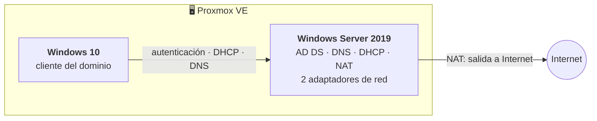

# 🪟 Windows Server 2019 sobre Proxmox

Administración de **Windows Server 2019** virtualizado en **Proxmox VE**, con clientes Windows 10 para probar cada servicio. Continúa lo visto en 1º con Windows Server 2016, ahora con escenarios más completos: red con dos adaptadores (NAT + interna), NFS, cuotas, impresión, escritorio remoto, servidor de aplicaciones, GPO, copias de seguridad y RAID.

> El dominio de los ejemplos es `servidor.local`; en los enunciados aparecía también `aso001.local`. Los datos son de laboratorio.

## Laboratorio en Proxmox



Para que el cliente tuviera dominio **y** salida a Internet, el servidor se configuró con **dos adaptadores de red**:

- **Adaptador externo**: obtiene IP del router (NAT de Proxmox) → salida a Internet.
- **Adaptador interno**: red con el cliente. El servidor es su puerta de enlace, servidor **DNS** (apuntando a `127.0.0.1` en sí mismo) y servidor **DHCP**.

El rol **NAT / enrutamiento** (Acceso remoto → "Enrutamiento") comparte la conexión del adaptador externo con la red interna.

## Active Directory, DNS y DHCP

1. **AD DS**: *Administrar › Agregar roles › Servicios de dominio de Active Directory*, y promover a controlador de un **bosque nuevo** `servidor.local`.
2. **Zona inversa**: para que `ping nombre.servidor.local` resuelva, se crea una zona de búsqueda inversa con el ID de red del adaptador interno.
3. **DHCP**: rol DHCP, ámbito con un rango de 10 direcciones, concesión sin caducidad y verificación desde un cliente Windows 10 que recibe la IP automáticamente.

```powershell
Install-WindowsFeature AD-Domain-Services, DNS, DHCP -IncludeManagementTools
Install-ADDSForest -DomainName "servidor.local" -InstallDns
# Ámbito DHCP de ejemplo
Add-DhcpServerv4Scope -Name "LAN" -StartRange 192.168.10.10 -EndRange 192.168.10.20 -SubnetMask 255.255.255.0
```

## Usuarios, grupos y directivas de contraseña

Prácticas de endurecimiento de cuentas con `gpedit.msc` (*Directivas de cuenta › Directiva de contraseñas*):

| Requisito | Directiva |
|---|---|
| Complejidad obligatoria | *La contraseña debe cumplir requisitos de complejidad* → Habilitada |
| Longitud mínima 8 | *Longitud mínima de la contraseña* → 8 |
| Vigencia 1–3 meses | *Vigencia mínima* 30 días, *vigencia máxima* 90 días |
| No repetir las 3 últimas | *Exigir historial de contraseñas* → 3 |

Luego: creación de usuarios (uno **deshabilitado**), grupos con miembros, comprobación de que al primer inicio se exige cambiar la contraseña y de que el usuario deshabilitado no aparece.

```powershell
New-ADUser -Name "userT01" -AccountPassword (Read-Host -AsSecureString) -Enabled $true -ChangePasswordAtLogon $true
New-ADGroup -Name "UsuariosT" -GroupScope Global -GroupCategory Security
Add-ADGroupMember -Identity "UsuariosT" -Members userT01, userT02
# Añadir un usuario desde PowerShell (ejercicio del examen)
```

## Carpetas compartidas

Dos formas de compartir, con permisos distintos:

- **Compartir básico** (pestaña *Compartir* de la carpeta): permisos de **solo lectura** para los usuarios/grupos. Se comprueba desde el cliente que el contenido se ve pero no se puede modificar.
- **Asistente para nuevo recurso compartido** (*Administrador del servidor › Servicios de archivos*): recurso **NFS** o SMB con permisos de **lectura y escritura**. El cliente debe activar *Servicios para NFS* en *Características de Windows*.

**Cuotas**: con el rol **Administrador de recursos del servidor de archivos (FSRM)** se limita una carpeta a 50 MB y se comprueba que un usuario no puede superarla.

## Impresión, escritorio remoto y aplicaciones

- **Impresora compartida**: se añade y comparte una impresora; todos los usuarios del dominio pueden usarla desde el cliente.
- **Escritorio remoto**: se habilita en servidor y cliente (*Propiedades del sistema › Acceso remoto*) y se conecta con `mstsc`.
- **Servidor de aplicaciones (RDS)**: rol de *Servicios de Escritorio remoto* para publicar una aplicación a la que el cliente accede por red.

## Relación de confianza entre dos servidores

Con un segundo Windows Server se establece una **relación de confianza** entre ambos dominios (*Dominios y confianzas de Active Directory*), de modo que uno pueda gestionar al otro.

## GPO: bloquear Windows Update

GPO que impide instalar actualizaciones (*Configuración del equipo › Plantillas administrativas › Componentes de Windows › Windows Update*), y configuración para que las directivas **no afecten a los administradores** (filtrado de seguridad o *loopback*).

## Copias de seguridad

- **Windows Server Backup**: copia completa de una carpeta a un disco virtual añadido en Proxmox.
- **Cobian Backup**: los tres tipos de copia sobre una carpeta de prueba:
  - **Completa**: copia todo el contenido seleccionado.
  - **Incremental**: solo los archivos nuevos desde la última copia.
  - **Diferencial**: los archivos modificados respecto a la completa.
- **Proxmox**: copia de seguridad de la propia máquina virtual.

## RAID 1 en Windows 10 (Proxmox)

Con dos discos virtuales añadidos en Proxmox (tamaño **dinámico**, nunca reservado por completo, o no se podrán usar en un RAID):

1. *Administración de discos* → inicializar (MBR) y crear un volumen simple en cada disco.
2. *Espacios de almacenamiento* → *Crear grupo* con los dos discos → tipo de resistencia **Reflejo doble** (espejo = RAID 1).
3. Comprobación: se desconecta un disco (*detach* en Proxmox) y el volumen sigue disponible gracias a la copia.

> 💡 **Incidencia anotada**: al sustituir el disco "dañado" por otro nuevo, Windows daba error al reincorporarlo al espejo; la solución fue rehacer el grupo de almacenamiento con el disco nuevo.
