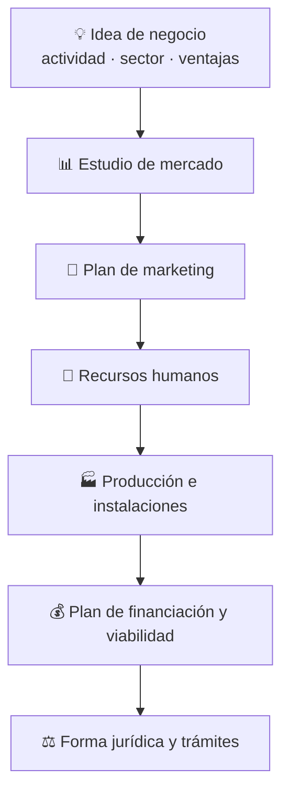

# 💼 EIE · Empresa e Iniciativa Emprendedora

Elaboración de un **plan de empresa** completo para una compañía ficticia del sector de la **ciberseguridad**, aplicando las herramientas de análisis estratégico y la normativa de creación de empresas.

> Se resume el trabajo sin reproducir los datos personales de los promotores (una sección del documento original). La empresa, su marca y sus cifras son **ficticias**, creadas como ejercicio.

## El proyecto

Plan de empresa de una **consultora de ciberseguridad** que ofrece protección (antimalware, firewalls, monitorización), auditorías, formación y concienciación, tanto a particulares como a empresas.

## Estructura del plan

### Análisis estratégico

| Herramienta | Para qué sirve |
|---|---|
| **DAFO** | Debilidades, Amenazas, Fortalezas y Oportunidades (interno/externo) |
| **PORTER** | Las 5 fuerzas: rivalidad, nuevos entrantes, sustitutos, proveedores y clientes |
| **PESTEL** | Factores Políticos, Económicos, Sociales, Tecnológicos, Ecológicos y Legales |
| **Buyer persona** | Perfil del cliente ideal al que se dirige el servicio |
| **Modelo Canvas** | Resumen del modelo de negocio en un lienzo |

### Plan de marketing

Estudio del mercado objetivo, canales de distribución, publicidad y política de precios (las 4 P: producto, precio, plaza y promoción).

### Recursos humanos, producción e instalaciones

Organigrama y perfiles del equipo, descripción del servicio y las instalaciones necesarias.

### Plan económico-financiero

Recursos propios y financiación externa, ayudas y subvenciones, y un **plan de viabilidad** con la previsión de ingresos y gastos.

### Forma jurídica y trámites

Elección de la forma jurídica y los **trámites de constitución**: registro del nombre, estatutos sociales, **ITPAJD**, alta en la **Agencia Tributaria (AEAT)** y en la Seguridad Social.

## Qué se aprende

- Transformar una idea en un **modelo de negocio** estructurado y defendible.
- Analizar un **mercado real** (el de la ciberseguridad) con DAFO, PORTER y PESTEL.
- Estimar la **viabilidad económica** de un proyecto.
- Conocer los **trámites legales** para constituir una empresa en España.
