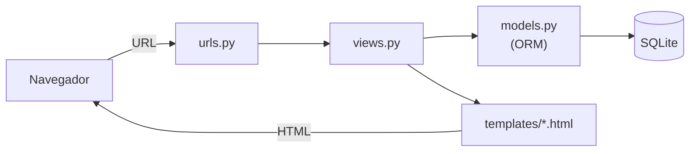

# 🐍 IAW · Implantación de Aplicaciones Web

Programación con **Python** (fundamentos, estructuras de datos, ficheros, `tkinter`, `matplotlib` y conexión a MySQL) y desarrollo web con el framework **Django**: del tutorial de un club de tenis a un proyecto propio con CRUD.

## Contenido

| Carpeta | Contenido |
|---|---|
| [`python-ejercicios/`](python-ejercicios/) | Ejercicios de Python: control de flujo, listas/tuplas/diccionarios/conjuntos, cadenas, ficheros, figuras ASCII, `tkinter` y MySQL |
| [`django-my_tennis_club/`](django-my_tennis_club/) | Proyecto Django del tutorial (socios y pistas de un club de tenis) |
| [`django-club/`](django-club/) | Proyecto Django propio: gestión de socios de un club con provincias y CRUD |

## Python

Colección de ejercicios que recorren los fundamentos del lenguaje:

| Fichero | Tema |
|---|---|
| [`helloworld.py`](python-ejercicios/helloworld.py) | Variables, ámbitos, funciones, tipos |
| [`Python_exercices.py`](python-ejercicios/Python_exercices.py) · [`Python_exercises2.py`](python-ejercicios/Python_exercises2.py) | Ejercicios variados de control de flujo |
| [`Tablas.py`](python-ejercicios/Tablas.py) · [`Sumatorios.py`](python-ejercicios/Sumatorios.py) | Bucles `while`/`for`, acumuladores |
| [`Max_min_list.py`](python-ejercicios/Max_min_list.py) | Listas: máximo y mínimo |
| [`tuple.py`](python-ejercicios/tuple.py) · [`Menu.py`](python-ejercicios/Menu.py) | Tuplas y conjuntos (`set`) con menú interactivo |
| [`Dictionary_and_strings.py`](python-ejercicios/Dictionary_and_strings.py) · [`dictionarys, strings and files.py`](python-ejercicios/dictionarys,%20strings%20and%20files.py) | Diccionarios, cadenas y ficheros |
| [`handling_files.py`](python-ejercicios/handling_files.py) | Lectura y escritura de ficheros |
| [`ahorcado.py`](python-ejercicios/ahorcado.py) | Juego del ahorcado (listas y bucles) |
| [`Triangulos.py`](python-ejercicios/Triangulos.py) · [`Rombo_list.py`](python-ejercicios/Rombo_list.py) | Figuras ASCII con bucles anidados |
| [`parabola.py`](python-ejercicios/parabola.py) | Gráficas con **matplotlib** |
| [`samples_tkinter.py`](python-ejercicios/samples_tkinter.py) | Interfaces gráficas con **tkinter** |
| [`mysql_prueba.py`](python-ejercicios/mysql_prueba.py) · [`tkinter_mysql.py`](python-ejercicios/tkinter_mysql.py) | Conexión a **MySQL** desde Python y desde tkinter |

```bash
python3 python-ejercicios/parabola.py        # necesita matplotlib
python3 python-ejercicios/Menu.py            # menú por consola
```

## Django



Ambos proyectos siguen el patrón **MVT** (Model-View-Template) de Django: los modelos definen las tablas (ORM), las vistas la lógica, las URLs el enrutado y las plantillas la presentación.

### `django-my_tennis_club` (tutorial)

Proyecto del tutorial de W3Schools, ampliado: modelos **Member** y **Court**, listado y detalle de socios, altas por formulario y varias plantillas. Incluye [`sql.txt`](django-my_tennis_club/sql.txt) con las consultas usadas y [`seed.sql`](django-my_tennis_club/seed.sql) con datos de ejemplo.

### `django-club` (proyecto propio)

Gestión de socios de un club con **provincias** y categorías (Infant, Junior, Adult, Senior). Modelos **Member** (con `province_id`) y **Province**, vistas de **listado, alta, edición y borrado** (CRUD) y formularios con `forms.py`.

### Cómo ejecutar un proyecto Django

```bash
cd django-club
python3 -m venv .venv && source .venv/bin/activate   # en Windows: .venv\Scripts\activate
pip install django
python manage.py migrate
sqlite3 db.sqlite3 < seed.sql        # cargar datos de ejemplo (opcional)
python manage.py runserver
```

## Notas

- Los **entornos virtuales** (`my_venv/`, `.venv/`) y las **bases de datos SQLite** no se incluyen (`.gitignore`); cada proyecto trae un **`seed.sql`** con datos ficticios para regenerarlas.
- La **`SECRET_KEY`** de Django se lee de la variable de entorno `DJANGO_SECRET_KEY` (con un valor de desarrollo por defecto); en producción debe ser un secreto propio.
- Las conexiones a MySQL de los ejemplos usan `root` sin contraseña, válido solo para un **servidor local de pruebas**.
- Los datos de socios y contactos son **ficticios**.
