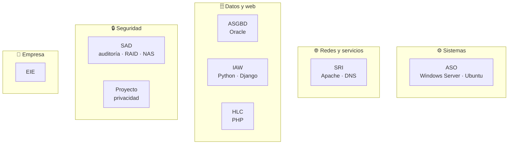

# 2️⃣ Segundo curso de ASIR · 2024-2025

Los módulos del segundo curso, con el código, el código fuente y los apuntes de cada uno. Predominan la administración de servidores (Windows y Linux sobre Proxmox), las bases de datos Oracle, el desarrollo web (PHP, Python y Django) y la seguridad.

## Módulos

| Módulo | Código | Qué incluye |
|---|---|---|
| [🖥️ ASO · Administración de Sistemas Operativos](ASO/README.md) | 0374 | Windows Server 2019 y Ubuntu Server sobre Proxmox (AD, DNS, DHCP, NAT, LDAP, Samba, CUPS, cuotas, acceso remoto) y *shell scripting* |
| [🗄️ ASGBD · Administración de SGBD](ASGBD/README.md) | 0377 | Oracle Database 19c: arquitectura, instancia, tablespaces, usuarios, privilegios, perfiles y roles; introducción a NoSQL |
| [🌐 SRI · Servicios de Red e Internet](SRI/README.md) | 0375 | Apache (acceso, rewrite, vhosts, autenticación) y DNS con BIND9 (caché, maestro, esclavo, subdominios); AWS EC2 |
| [🐍 IAW · Implantación de Aplicaciones Web](IAW/README.md) | 0376 | Python (fundamentos, tkinter, matplotlib, MySQL) y dos proyectos **Django** con CRUD |
| [🔒 SAD · Seguridad y Alta Disponibilidad](SAD/README.md) | 0378 | SAI, videovigilancia y RGPD, cifrado, malware, auditoría (nmap, Hydra), recuperación de datos, RAID y NAS |
| [🐘 HLC · Desarrollo web con PHP](HLC/README.md) | — ¹ | PHP: ejercicios, agenda en JSON y CRUD con MySQL |
| [💼 EIE · Empresa e Iniciativa Emprendedora](EIE/README.md) | 0381 | Plan de empresa de una consultora de ciberseguridad (DAFO, PORTER, PESTEL, Canvas) |
| [🛡️ Proyecto · Curso de Privacidad Digital](proyecto-privacidad/README.md) | 0379 | Proyecto de fin de ciclo: formación en privacidad (DNS cifrado, VPN, TrueNAS…) |

¹ HLC = **Horas de Libre Configuración**, módulo autonómico sin código estatal; aquí dedicado a PHP.

## Código del curso

| Tipo | Dónde |
|---|---|
| SQL (Oracle) | [ASGBD](ASGBD/) |
| Bash | [ASO › scripts](ASO/linux/scripts/README.md) |
| Python + Django | [IAW](IAW/README.md) |
| PHP | [HLC](HLC/README.md) |

## Nota sobre virtualización

Casi todas las prácticas de sistemas y redes se hicieron sobre **Proxmox VE** (máquinas virtuales de Windows Server, Ubuntu Server, Windows 10 y clientes), además de VirtualBox para algunas de seguridad. Las bases de datos de los proyectos Django y los entornos virtuales de Python **no se incluyen**; cada proyecto trae un `seed.sql` con datos ficticios para regenerarlos.
