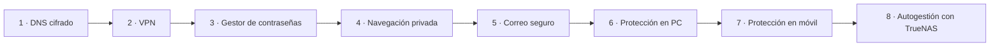

# 🛡️ Proyecto de fin de ciclo · Curso de Privacidad Digital

Proyecto final del ciclo (módulo **Proyecto**): el diseño de un **curso de formación en privacidad digital** de nivel básico-intermedio, dirigido a usuarios y técnicos, con un enfoque **práctico** (configurar herramientas reales) y encuadrado en el marco normativo europeo (**RGPD** y **LOPDGDD**).

> Resumen del proyecto. Se omiten los datos personales de la portada (autor y tutor). Es el precedente directo del repositorio [`nas-homelab`](https://github.com/G0rri/nas-homelab).

## Idea central: el modelo de amenaza

Antes de aplicar cualquier herramienta hay que definir **contra quién o qué** queremos protegernos. El esfuerzo y las herramientas cambian según el nivel:

| Nivel | Adversario | Herramienta principal |
|---|---|---|
| **Bajo** | Anunciantes y rastreo comercial | DNS privado (Quad9), navegador *privacy-first* (Brave), antirrastreo |
| **Medio** | Atacantes en redes públicas (Wi-Fi) | **VPN** de confianza (ProtonVPN, Mullvad) |
| **Alto** | Censura y vigilancia estatal | **Tor**, GrapheneOS, infraestructura propia |

## Las 8 tareas del curso

### 1. DNS cifrado

El DNS tradicional viaja en texto plano y expone el historial de navegación. Solución: **DoH** (DNS over HTTPS) y **DoT** (DNS over TLS) con resolutores privados. Comparativa de **Quad9** (Suiza, *no-logs*, bloqueo de malware), Cloudflare, AdGuard y Google DNS. Validación de **fugas DNS** con DNSLeakTest e ipleak.net. Distinción entre cifrado (DoH/DoT) y autenticidad (**DNSSEC**).

### 2. VPN

Qué es y qué **no** es una VPN (no da anonimato total ni protege del malware). Comparativa **OpenVPN** (AES-256) vs **WireGuard** (ChaCha20, más rápido y auditable). Política de **no-logs** verificada por auditorías, **Kill Switch** y autoalojamiento con WireGuard.

### 3. Gestores de contraseñas

Por qué usar uno, cómo crear una **contraseña maestra** robusta y activar **2FA** (preferiblemente con app local o llave hardware **YubiKey**). Comparativa de **Bitwarden**, **Proton Pass** y **KeePassXC**, y la opción de autoalojar **Vaultwarden**. Comprobación de brechas con *Have I Been Pwned*.

### 4. Navegación privada y antirrastreo

Técnicas de rastreo (cookies, *fingerprinting*, WebRTC) y navegadores resistentes: **Tor**, **Brave**, **Firefox/LibreWolf**. Extensiones imprescindibles (uBlock Origin, Privacy Badger), ajustes (`resistFingerprinting`, desactivar WebRTC) y auditoría con **Cover Your Tracks** (EFF). El **modo incógnito** no protege frente al rastreo externo.

### 5. Correo electrónico seguro

Proveedores con cifrado **E2EE** (**ProtonMail**, **Tutanota**) frente a Gmail/Outlook. Cifrado **PGP/GPG** (clave pública/privada) y sus límites (no cifra asunto ni metadatos). **Alias** de correo (SimpleLogin, AnonAddy) y correos temporales para evitar la correlación de datos.

### 6. Protección en el PC

*Hardening* de **Windows 11** (ShutUp10++, WPD, cuenta local, cifrado con **BitLocker**/**VeraCrypt**), Linux (ufw, servicios mínimos, *sandboxing* con Firejail/Flatpak) y macOS. Gestión granular de permisos y cifrado de disco (**LUKS**/FileVault).

### 7. Protección en el móvil

Comparativa iOS / Android / **GrapheneOS** (exclusivo de Google Pixel por el chip **Titan M2** y *Verified Boot*). Permisos por app, perfiles aislados (**Shelter**), apps FOSS (**Signal**, **Aegis**) y mensajería segura (Signal, Session, Briar).

### 8. Autogestión con TrueNAS Scale

Infraestructura privada autoalojada: cifrado **ZFS** (AES-256-GCM, *copy-on-write*, *snapshots*, integridad con *checksums*), autenticación reforzada (SSH con ed25519, 2FA), exposición segura con **Cloudflare Tunnels**, y servicios propios — **Nextcloud** (nube), **Immich** (fotos), **Vaultwarden** (contraseñas), **Jellyfin** (medios), **AdGuard Home** (DNS), **Home Assistant** (domótica) — con copias de seguridad y replicación.

## Cierre del proyecto

El documento se completa con la planificación habitual de un proyecto: **recursos humanos** (perfiles y certificaciones del equipo), **recursos materiales**, **cronograma** (diagrama de Gantt), **presupuesto** desglosado por tarea, un **glosario** técnico extenso y la **bibliografía**.

## Conclusión

La privacidad no es un producto que se compra, sino un **proceso continuo**: elegir proveedores responsables, auditar permisos periódicamente y combinar medidas técnicas con hábitos y conocimiento. El proyecto demuestra que la privacidad es **técnicamente viable** hoy, y que el obstáculo real es democratizar ese conocimiento.
